# sesmesh — Design Document

| | |
|---|---|
| Document | 02 — Design |
| Status | Draft v0.1 (for review) |
| Date | 2026-11-12 |
| Related | [01 — Product Specification](01-product-specification.md) (requirement IDs `FR-*`, `NFR-*`, references `[R*]`), [03 — Implementation Plan](03-implementation-plan.md) |

---

## 1. Design principles

1. **Exact definition, discrete sampling.** The surface is defined by an exact
   implicit function (the Quan–Stamm characterization [R6]); discretization
   only decides *where* we sample it, never *what* we compute. Vertices are
   exact roots of that function on grid edges; normals are its exact gradient.
2. **Pay for the surface, not the volume.** All heavy work happens in bricks
   that intersect the surface (narrow band), found by provably conservative
   bounds. Memory and time scale with surface area.
3. **Reference first, optimized second.** Every optimized path (SIMD kernel,
   culling, parallel assembly) has a simple scalar reference implementation;
   tests compare them.
4. **Deterministic parallelism.** Work is partitioned into independent bricks;
   results are concatenated in a fixed order; floating-point reductions are
   performed in a fixed order. No output depends on scheduling.
5. **Library first.** The core takes spheres and returns a mesh. File formats,
   radii tables, CLI and exporters are layers on top, behind Cargo features.
6. **Small, stable public API.** No third-party types in public signatures;
   `#[non_exhaustive]` on public enums/structs that may grow.
7. **Safe Rust.** `#![forbid(unsafe_code)]` in all crates; SIMD through a safe
   crate (`fearless_simd` [R48]).

---

## 2. Mathematical foundation

### 2.1 Notation

* Atoms $i = 1..N$ with centres $\mathbf c_i$ and radii $r_i > 0$; probe radius
  $r_p \ge 0$; expanded radii $R_i = r_i + r_p$.
* SAS solid (open): $A = \bigcup_i B^\circ(\mathbf c_i, R_i)$. SAS $= \partial A$.
* **Probe-accessible region** (set of feasible probe centres, closed):
  $P = \mathbb R^3 \setminus A = \{\mathbf x : \lVert\mathbf x - \mathbf c_i\rVert \ge R_i\ \forall i\}$.
* **Excluded region**: $E = \{\mathbf x : d(\mathbf x, P) \ge r_p\}$, the complement of the
  union of all non-overlapping probe balls [R3]. **SES** $= \partial E$.

### 2.2 The SES field

We sample the scalar field

$$F(\mathbf x) = r_p - d(\mathbf x, P),$$

with $F < 0$ inside the molecule, $F > 0$ in solvent, $F = 0$ on the SES
(sign convention of an SDF, negative inside). Properties used throughout:

| # | Property | Use |
|---|---|---|
| P1 | $F$ is 1-Lipschitz (distance functions are). | Conservative culling of bricks (§7.3). |
| P2 | $F(\mathbf x) = r_p$ for $\mathbf x \in P$ (maximum value). | Everything outside the SAS is trivially "outside". |
| P3 | Inside $E$: $\lvert F(\mathbf x)\rvert = \operatorname{dist}(\mathbf x, \mathrm{SES})$ exactly. Outside $E$: $0 < F(\mathbf x) \le \operatorname{dist}(\mathbf x, \mathrm{SES})$. | Good interpolation behaviour; exact projection from inside (P6). |
| P4 | $F(\mathbf x) \le s_{\mathrm{vdW}}(\mathbf x) := \min_i(\lVert\mathbf x-\mathbf c_i\rVert - r_i)$, because $d(\mathbf x,P) \ge R_i - \lVert\mathbf x-\mathbf c_i\rVert$ for every $i$. | Cheap "inside" test. |
| P5 | Where the closest point $\mathbf p(\mathbf x) \in P$ is unique and $\mathbf x \notin P$: $\nabla F(\mathbf x) = (\mathbf p - \mathbf x)/\lVert\mathbf p - \mathbf x\rVert$. On the SES the **outward unit normal** is $\mathbf n = (\mathbf p - \mathbf x)/r_p$. | Analytic normals (FR-MESH-3). |
| P6 | For $\mathbf x \in E$, $\mathbf x^* = \mathbf p + r_p(\mathbf x - \mathbf p)/\lVert\mathbf x - \mathbf p\rVert$ lies on the SES (it is on segment $\mathbf x\mathbf p$ and $d(\mathbf x^*,P) = r_p$ by P1). | Exact vertex re-projection after smoothing (§9.4). |

Proof sketch of P3 (inside): let $d = d(\mathbf x, P) \ge r_p$ with closest point $\mathbf p$.
The point $\mathbf y$ on segment $\mathbf x\mathbf p$ at distance $r_p$ from $\mathbf p$ satisfies
$d(\mathbf y,P) \le r_p$ and, by P1, $d(\mathbf y,P) \ge d - (d - r_p) = r_p$; so $\mathbf y$ is on
the SES at distance $d - r_p = \lvert F(\mathbf x)\rvert$, and no SES point is closer, again by P1.

This is the implicit representation proven complete by Quan & Stamm [R6]: all
SES singularities (self-intersecting tori, intersecting reentrant patches) are
level-set features of $F$ and need no special handling.

**SAS and vdW surfaces** (FR-SURF-2) use
$F_{\mathrm{SAS}}(\mathbf x) = \min_i(\lVert\mathbf x - \mathbf c_i\rVert - R_i)$ and
$F_{\mathrm{vdW}}(\mathbf x) = \min_i(\lVert\mathbf x - \mathbf c_i\rVert - r_i)$: 1-Lipschitz,
exact on the zero set, normal $(\mathbf x - \mathbf c_{i^*})/\lVert\cdot\rVert$ of the active sphere.
$r_p = 0$ for SES is routed to the vdW field.

### 2.3 Closest point on the SAS (evaluating $d(\mathbf x, P)$)

For $\mathbf x \in A$ the closest point of $P$ lies on $\partial A = \partial P$. $\partial A$ is a
union of closed spherical faces, circular arcs (pairwise sphere intersections)
and vertices (triple intersections). A closest point lies in the relative
interior of a face, of an arc, or is a vertex; on a sphere the only interior
local minimum of distance is the radial projection, on a circle the planar
projection. Hence $d(\mathbf x, P)$ is the minimum over three candidate classes,
each subject to a **validity test** (the candidate point must not lie strictly
inside any other expanded sphere):

| Class | Candidate point $\mathbf q$ | Distance | Valid iff |
|---|---|---|---|
| **S** — sphere $i$ (→ convex SES patch) | $\mathbf c_i + R_i\,(\mathbf x-\mathbf c_i)/\lVert\mathbf x-\mathbf c_i\rVert$ | $\lvert\,\lVert\mathbf x-\mathbf c_i\rVert - R_i\rvert$ | $\lVert\mathbf q-\mathbf c_k\rVert \ge R_k$ for all $k \in N(i)$ |
| **C** — circle $(i,j)$ (→ saddle/toroidal patch) | $\mathbf m + \rho\,\mathbf w/\lVert\mathbf w\rVert$ | $\sqrt{a^2 + (\lVert\mathbf w\rVert-\rho)^2}$ | $\lVert\mathbf q-\mathbf c_k\rVert \ge R_k$ for all $k \in K(i,j)$ |
| **V** — SAS vertex $(i,j,k)$ (→ concave patch) | precomputed point $\mathbf v$ | $\lVert\mathbf x - \mathbf v\rVert$ | precomputed (exposed vertices only) |

Circle $(i,j)$: $D = \lVert\mathbf c_j-\mathbf c_i\rVert$, exists iff $\lvert R_i-R_j\rvert < D < R_i+R_j$;
$\mathbf u = (\mathbf c_j-\mathbf c_i)/D$, $t = (D^2+R_i^2-R_j^2)/(2D)$, centre $\mathbf m = \mathbf c_i + t\mathbf u$,
radius $\rho = \sqrt{R_i^2-t^2}$. For query $\mathbf x$: $\mathbf y = \mathbf x-\mathbf m$,
$a = \mathbf y\cdot\mathbf u$, $\mathbf w = \mathbf y - a\mathbf u$. $N(i)$ = spheres intersecting sphere $i$;
$K(i,j)$ = spheres that cut circle $(i,j)$.

Degeneracies: $\mathbf x = \mathbf c_i$ (class S undefined → skip; that point is deep
inside) and $\lVert\mathbf w\rVert \approx 0$ (all circle points equidistant → the minimum over
the exposed arc equals the distance to any exposed point, which is attained at
an arc endpoint = a class-V vertex, or, for a fully exposed circle, at an
arbitrary point which we pick deterministically).

**Numerical tolerance.** Validity uses $\lVert\mathbf q-\mathbf c_k\rVert^2 \ge R_k^2 - \tau_k$. A wrong
validity decision for a candidate within $\varepsilon$ of a blocking sphere changes the
computed distance by $O(\varepsilon)$, because the true closest point is then on the
nearby arc/vertex — the field is continuous in these decisions. Tolerances are
therefore accuracy parameters, not topology hazards. The only ill-posed
inputs are exactly-fitting probes (e.g. a probe that fits a tetrahedral hole
exactly); they are decided deterministically by the precomputation tolerance
(§6.4).

### 2.4 Cavities

$P$ may have bounded connected components (probe-accessible but enclosed
pockets). Each produces closed SES components whose outward normals point
*into* the enclosed solvent, so they have **negative signed volume**; external
components have positive signed volume. This gives an exact, cheap
classification on the mesh (§9.2). Removing cavity components equals
computing the SES with only the unbounded component of $P$, except in the
degenerate case where a cavity's probe balls touch external probe balls; then
both belong to the same mesh component and are kept (documented behaviour,
cf. Spec §8).

---

## 3. Architecture

### 3.1 Workspace layout

```
sesmesh/                         (repository root, Cargo workspace)
├── Cargo.toml                   workspace manifest, shared lints/profile
├── crates/
│   ├── sesmesh/                 library crate (all functionality)
│   ├── sesmesh-cli/             binary crate `sesmesh` (thin clap front-end)
│   └── sesmesh-testkit/         dev-only: oracles, analytic references, generators
├── tests/data/                  small CC0 PDB/mmCIF/XYZ fixtures + reference values
├── benches/                     criterion benches (in crates/sesmesh/benches)
├── fuzz/                        cargo-fuzz targets (parsers, MC tables)
├── xtask/                       dev automation: fetch benchmark set, validation runs
└── docs/
```

### 3.2 Library module map

```
sesmesh
├── lib.rs            public re-exports, crate docs, feature gates
├── error.rs          Error, Result
├── diag.rs           Diagnostics (warnings), StageTimings, Counters
├── params.rs         SurfaceParams, Resolution/Quality, CavityMode, RefineMode, LOD mapping
├── engine.rs         SurfaceEngine: orchestrates the pipeline, owns reusable buffers
├── par.rs            parallel facade (rayon or sequential)
├── structure/        AtomRecord, Structure, Model, Element (+ periodic table), selection
├── io/               detect.rs, compress.rs, pdb.rs, cif/{lexer.rs, atom_site.rs, assembly.rs},
│                     xyz.rs, pqr.rs
├── radii/            tables/{bondi.rs, mantina.rs, alvarez.rs, protor.rs}, custom.rs, assign.rs
├── geom/             vec.rs (internal Vec3 f64/f32), cells.rs (cell lists), neighbors.rs,
│                     circles.rs, arrangement.rs (exposed arcs, SAS vertices), predicates.rs
├── field/            lattice.rs, bricks.rs (classification), gather.rs (per-brick candidates),
│                     kernel.rs (SIMD-generic evaluation), reference.rs (scalar f64 oracle),
│                     query.rs (point queries: value, gradient, closest feature)
├── mesh/             mc_tables.rs, extract.rs (per-brick MC + edge refinement),
│                     assemble.rs (global indexing), mesh.rs (Mesh type), components.rs,
│                     measure.rs, smooth.rs, decimate.rs, validate.rs
└── export/           fmt.rs (fast fixed-point formatting), obj.rs, ply.rs, msms.rs, csv.rs, stats.rs
```

### 3.3 Pipeline

```mermaid
flowchart LR
  A[Input file] --> B[Parse<br/>PDB / mmCIF / XYZ / PQR]
  B --> C[Select atoms<br/>model, altloc, H, waters]
  C --> D[Assign radii]
  D --> E[Spheres]
  E --> F[Geometry precompute<br/>cell lists, neighbours,<br/>circles, exposed arcs,<br/>SAS vertices]
  F --> G[Brick classification<br/>touched set, cheap bounds,<br/>Lipschitz test]
  G --> H[Per surface brick:<br/>gather candidates, SIMD field,<br/>MC, edge refinement,<br/>normals, attributes]
  H --> I[Global assembly<br/>prefix sums, cross-brick<br/>index resolution]
  I --> J[Components, cavities,<br/>measurements]
  J --> K[Optional: smoothing +<br/>re-projection, decimation]
  K --> L[Export OBJ / PLY / MSMS<br/>+ stats]
```



Stages B–D are the *structure layer* (feature-gated I/O); E–K the *surface
core* (always present); L the *export layer*.

---

## 4. Data model

### 4.1 Structure layer

* **`AtomRecord`** — one parsed atom: serial, atom name, alt-loc, residue name,
  chain IDs (auth and label), residue sequence number, insertion code,
  coordinates (`[f64; 3]`), occupancy, B-factor, element (`Element` enum,
  Z = 0..118 plus `Unknown`), formal charge, `het` flag, model number, and
  optional file-provided radius (PQR, extXYZ). Strings are stored in a
  per-structure string interner (residue/atom names repeat massively), so a
  record is ~64 bytes.
* **`Structure`** — `Vec<Model>`; each model holds its atoms (SoA-friendly
  `Vec<AtomRecord>`), plus parsed assembly operators (mmCIF/PDB) and metadata
  (source path, format, data block name).
* **`Selection`** — declarative filter (model, altloc policy, hydrogens,
  waters, hetero, chains, residue exclusions) plus optional user predicate
  (library only).

### 4.2 Surface core

* **`Sphere { center: [f64; 3], radius: f64 }`** — core input. The engine keeps
  a mapping from internal (spatially reordered) indices back to the caller's
  indices for per-vertex atom attributes.
* **`SurfaceParams`** — kind (SES/SAS/vdW), probe radius, `Resolution`
  (spacing, quality preset or vertex density), cavity mode and filters,
  refinement mode, normals mode, attribute flags, post-processing options,
  resource limits, brick size (expert), SIMD level override (expert).
* **`Mesh`** — `positions: Vec<[f32;3]>`, `normals: Vec<[f32;3]>`,
  `triangles: Vec<[u32;3]>`, optional `vertex_atom: Vec<u32>`,
  `vertex_patch: Vec<PatchKind>` (`Convex | Saddle | Concave`),
  `vertex_component: Vec<u32>`, and `components: Vec<ComponentInfo>`
  (area, signed volume, Euler characteristic, genus, is_cavity, triangle range).
* **`SurfaceOutput`** — `mesh`, `stats` (counts, area, volume, timings),
  `diagnostics` (warnings).

### 4.3 Internal geometry data (SoA, f64 for construction, f32 copies for kernels)

| Data | Layout | Size (typical) |
|---|---|---|
| Spheres (reordered by cell) | `cx, cy, cz, r, R` arrays + `orig_index` | N |
| Neighbour lists $N(i)$ | CSR (`offsets: Vec<u32>`, `ids: Vec<u32>`) | 30–60 per atom (transient) |
| Exposed circles | `m, u, e1, e2, rho, (i, j)`, blocker CSR $K(i,j)$ | ≈ 2–4 per surface atom |
| SAS vertices (exposed triple points) | `v, (i, j, k)` | ≈ 2 per surface atom |
| Exposed-sphere flags | bitset | N |
| Cell lists for spheres / circles / vertices | CSR over a uniform cell grid | — |

---

## 5. Input subsystem

### 5.1 Build vs buy

`pdbtbx` [R53] is a full read/edit/write model but is heavier than needed,
loads metadata we ignore, and its maintenance status is uncertain. GEMMI [R46]
is C++. sesmesh therefore ships **small, purpose-built, zero-copy readers**
that extract only coordinate-level data; GEMMI and `pdbtbx` are used only as
*test oracles* (atom counts/coordinates must match on the fixture corpus).

### 5.2 Common machinery

* `io::detect`: by extension (`.pdb .ent .cif .mmcif .xyz .extxyz .pqr`, each
  optionally `.gz`), then by sniffing the first 4 KiB (`data_` / `loop_` /
  `_atom_site.` → mmCIF; `ATOM  `/`HETATM`/`HEADER` → PDB; integer first line →
  XYZ). `--format` overrides.
* `io::compress`: gzip via `flate2` with the `zlib-rs` backend [R51]; input is
  fully decompressed into memory (structure files are ≤ a few hundred MB; 3J3Q
  mmCIF ≈ 200 MB) because all parsers work on `&[u8]`.
  Decompressed size is capped (`ReadOptions::max_decompressed_bytes`, default
  8 GiB) to stop decompression bombs; exceeding it is `Error::ResourceLimit`.
* Files are read with a single `std::fs::read`. (Memory-mapping was dropped:
  `memmap2::Mmap::map` is `unsafe`, which the crate forbids, and reading is
  not the bottleneck.)
* Parsers operate on bytes (no UTF-8 validation of the whole file), split lines
  with `memchr`, and parse numbers with a fast float parser (`fast-float2`) /
  hand-written integer parsing. Errors carry 1-based line and column.

### 5.3 PDB reader (FR-IN-1)

* Fixed columns per v3.3 [R38]: record name 1–6, serial 7–11 (decimal or
  hybrid-36 [R41]), atom name 13–16, altloc 17, resName 18–20, chainID 22,
  resSeq 23–26 (decimal or hybrid-36), iCode 27, x/y/z 31–38/39–46/47–54,
  occupancy 55–60, tempFactor 61–66, element 77–78, charge 79–80.
* Short lines are accepted if they contain the coordinates; missing
  occupancy → 1.0.
* Element inference when columns 77–78 are blank: standard rule on the atom
  name field (columns 13–14 right-justified element; e.g. `" CA "` → C but
  `"CA  "` → Ca), with residue-aware disambiguation for common ions
  (CA/ZN/MG/FE in single-atom HETATM residues).
* `MODEL`/`ENDMDL` define models; files without them have one model.
* `REMARK 350 BIOMT` parsed when assemblies are requested.
* Parallelism: lines are independent, so large files are split into ≈ 4 MB
  newline-aligned chunks parsed in parallel; per-chunk results are concatenated
  in order (model boundaries handled by a sequential fix-up pass).

### 5.4 mmCIF reader (FR-IN-2, FR-IN-8)

* **Lexer** implements CIF 1.1 tokens: `data_`, `loop_`, `save_`, tag names,
  unquoted values, `'…'`/`"…"` (closing quote must be followed by whitespace),
  `;`-delimited multi-line text fields, comments, `?` (unknown) and `.`
  (inapplicable). Zero-copy `&[u8]` tokens.
* **`_atom_site` extraction**: map tag names to column indices once; then
  stream rows. Uses `type_symbol`, `label_atom_id`/`auth_atom_id`,
  `label_alt_id`, `label_comp_id`/`auth_comp_id`,
  `label_asym_id`/`auth_asym_id`, `label_seq_id`/`auth_seq_id`,
  `pdbx_PDB_ins_code`, `Cartn_x/y/z`, `occupancy`, `B_iso_or_equiv`,
  `pdbx_formal_charge`, `pdbx_PDB_model_num`, `group_PDB`. Missing optional
  columns get defaults; missing coordinates → error.
* Performance: lexing and row conversion are sequential (quotes and text
  fields make blind splitting unsafe). Measured ≈ 350 MiB/s on one Apple
  Silicon core (4V6X, 1AON), above the 200 MB/s target, so the planned
  parallel row conversion is deferred to Phase 9 tuning if profiling shows a
  need. 3J3Q (2.44 M atoms, gzipped) reads in ≈ 0.8 s.
* **Assemblies**: parse `pdbx_struct_assembly_gen` (assembly id, operator
  expression such as `(1-60)` or `(1,2)(3-5)`, asym id list) and
  `pdbx_struct_oper_list` (3×4 matrices); expand by applying operators to the
  selected chains. Chain IDs of generated copies get an operator suffix.
* The data block is the one named by `--block`, else the first block that
  contains `_atom_site`.

### 5.5 XYZ / extended XYZ / PQR (FR-IN-3..5)

* XYZ: frames of `N`, comment, `N` atom lines (`symbol|Z x y z ...`); frame
  selection by index; tolerant of trailing blank lines.
* Extended XYZ: parse `key=value` pairs of the comment line (quoted values),
  find `Properties=` descriptor (`name:type:ncols` triplets [R43]) to locate
  `species`/`pos` columns and an optional radius column named by the user.
* PQR: whitespace-delimited `ATOM/HETATM serial name resName [chain] resSeq x y z charge radius`
  [R44]; the optional chain column is detected by field count.

### 5.6 Selection and radii (FR-SEL, FR-RAD)

* Selection order: model → alt-loc resolution → hydrogens (element H or D) →
  waters → hetero → chains → residue exclusions → user predicate.
* Alt-locs are resolved **per residue** (chain, resSeq, iCode), so a residue
  never mixes conformers: keep the letter with the highest total occupancy
  (ties → first appearing), or the first letter, or a requested letter (falling
  back to highest occupancy where absent), or everything. Atoms with a blank
  alt-loc are always kept.
* Radii assignment returns `Vec<f64>` aligned with the selected atoms plus
  warnings. Lookup order: file radius (if enabled) → custom rules (exact
  `resName:atomName`, then wildcard `*:atomName`, `resName:*`, then element) →
  built-in table → fallback radius.
* Built-in tables are `const` arrays indexed by atomic number, transcribed
  from the cited papers [R34–R37], each value unit-tested against the source
  table (and cross-checked with an independent machine-readable transcription,
  e.g. QCElemental's Mantina table). Representative Bondi values (Å): H 1.20,
  C 1.70, N 1.55, O 1.52, F 1.47, P 1.80, S 1.80, Cl 1.75, Br 1.83, I 1.98;
  Mantina additions include Be 1.53, B 1.92, Al 1.84, Ca 2.31, Ge 2.11,
  Sb 2.06, Bi 2.07 [R35]. Main-group values follow Mantina's Table 12 (which
  reproduces Bondi), except H, where Mantina substitutes 1.10 Å and the Bondi
  set keeps Bondi's 1.20 Å. Transition metals and U follow the "Bondi" column
  of Alvarez's Table 1. Elements in neither paper (Fe, Mn, Co, ...) use the
  fallback radius with a warning. Alvarez values come from Table 1 of [R36]
  (93 elements; bracketed rough estimates included and marked).
* ProtOr [R37] maps (residue, atom) to atom classes (e.g. `C3H0`, `C4H2`,
  `N3H1`, `O1H0`, `S2H0`) with class radii from the paper; the 506
  assignments (amino acids, nucleotides, a few modified residues) are
  generated from FreeSASA's `protor.config`. Unclassified atoms fall back to
  Bondi element radii; explicit hydrogens trigger a warning, since united-atom
  radii already include them.
* Custom radius file: TOML with `base`, `fallback`, an `[elements]` table and
  an `[atoms]` table keyed `"RES:ATOM"` (`*` wildcards); unknown keys and
  invalid radii are rejected with the parser's position.

---

## 6. Geometry precomputation (surface core)

All constructions use `f64`. Spheres with $R_i = 0$ are removed; exact
duplicates (same centre within $10^{-9}$ Å and same radius) are collapsed (the
first index keeps ownership for attributes).

### 6.1 Frame and spatial reordering

* The arrangement stores `f64` coordinates in the input frame. The field
  engine (§7) chooses its frame origin $\mathbf o$ = centroid of the bounding
  box rounded to a multiple of the grid spacing $h$ (known only there), so the
  sampling lattice coincides with multiples of $h$ in input coordinates and
  kernel coordinates are small (f32 precision, §7.5).
* Spheres are sorted by the Morton code of their cell (ties: input index) to
  improve locality in all later stages; `orig` maps internal to input
  indices.

### 6.2 Cell lists

Uniform grid with cell size $s = 2\max_i R_i$ (≈ 6.4 Å for proteins with
$r_p = 1.4$), built by counting sort (cell id per sphere → histogram →
prefix sum → scatter) into CSR form (parallel in Phase 5). Very sparse inputs
double the cell size until the grid has at most $\max(65\,536, 8N)$ cells. Range queries visit the cells
overlapping a query ball. The same structure (different cell sizes) indexes
exposed circles (by centre, with $\rho_{\max}$ padding) and SAS vertices.

### 6.3 Neighbours and circles

1. If sphere $i$ lies inside sphere $j$ ($D + R_i \le R_j$; exact duplicates keep
   the lower input index), $i$ is marked **contained** and ignored by every
   later stage. Then
   $N(i) = \{j \ne i : \lVert\mathbf c_i - \mathbf c_j\rVert < R_i + R_j\}$ over
   non-contained spheres, sorted by $j$.
2. For each pair $i < j$, $j \in N(i)$, neither contained: build the circle
   frame $(\mathbf m, \mathbf u, \mathbf e_1, \mathbf e_2, \rho)$ with a deterministic orthonormal basis.

### 6.4 Exposed arcs and SAS vertices (the "SAS arrangement")

For circle $(i,j)$ and each $k \in N(i) \cap N(j)$, the set of circle points
inside ball $k$ is an angular interval: with $\mathbf g = \mathbf m - \mathbf c_k$,
$\lVert\mathbf q(\theta)-\mathbf c_k\rVert^2 = \lVert\mathbf g\rVert^2 + \rho^2 + 2\rho(\cos\theta\,\mathbf e_1\!\cdot\!\mathbf g + \sin\theta\,\mathbf e_2\!\cdot\!\mathbf g) < R_k^2$,
i.e. $\cos(\theta - \varphi_k) < \beta_k$ — empty, full, or an interval centred at
$\varphi_k + \pi$. The interval endpoints $\varphi_k \pm \alpha_k$ are computed as unit
vectors with angle-addition formulas, and intervals are sorted and merged
(with wrap-around) on a monotone trig-free *pseudo-angle* of those vectors;
`atan2` is evaluated only for the arcs of exposed circles. Exit early when a
single sphere covers the whole circle. (This trig-free formulation made the
circle stage ≈ 1.8× faster on 1AON.)

* Circle **buried** if the union covers the whole circle → discarded.
* Otherwise its **blocker list** $K(i,j)$ = the $k$ with non-empty intervals; the
  endpoints of exposed arcs are **triple points** — probe positions touching
  three atoms (= reduced-surface vertices [R9]). Each triple $i<j<k$ is
  enumerated exactly once, from exposed circle $(i,j)$ and blocker $k > j$: both
  crossing points are computed and kept if no other neighbour of $i$ contains
  them (any sphere containing a point of sphere $i$ intersects sphere $i$), a
  single source of truth independent of how the arcs were merged.
* Sphere $i$ is **exposed** iff $N(i) = \varnothing$ or it has at least one exposed
  circle. A buried sphere is still a blocker but never a class-S candidate.
* Tolerance: absolute `EPS` = $10^{-9}$ Å for containment, intersection and
  "strictly inside" tests (`f64`). This deterministic rule decides
  exactly-fitting probes (§2.3); symmetric lattices and cages are covered by
  tests. An optional deterministic jitter (as used by NanoShaper for
  degenerate configurations [R13]) remains possible if such inputs prove
  problematic in practice.

Cost: $O(N\bar k^2)$; output size is proportional to the number of surface
atoms. Measured single-threaded on Apple Silicon (Plan T2.9): 1CRN 3.3 ms,
4HHB 56 ms, 1AON (59 k atoms) 0.73 s, 4V6X (238 k atoms) 3.0 s; dominated by
the ≈ 20 blocker tests of each of the ≈ 20 candidate circles per atom.
Parallelisation per sphere follows in Phase 5.

---

## 7. Field evaluation on a sparse brick lattice

### 7.1 Lattice and bricks

* Sample lattice: points $\mathbf o + h\,(i,j,k)$, integer $i,j,k$.
* **Brick** = $B^3$ cells (default $B = 10$ since Phase 6 — measured 4–10 %
  faster end to end than 8 on 4HHB and 1AON; 12 is similar, 4/6/14/16 slower;
  tunable 2–32). A brick evaluates its own $(B+1)^3$ samples (an apron including its
  "+" faces), so bricks are fully independent work items. Sample duplication
  overhead $((B+1)/B)^3$ (1.42× at $B=8$, 1.20× at $B=16$) is traded for zero
  inter-brick synchronization; P7 below guarantees consistency.
* Brick key: `(bx, by, bz)` packed into a `u64`; surface bricks are kept in a
  sorted `Vec` (z-y-x order), plus a hash map key → index for neighbour
  lookups (`FxHashMap`).

### 7.2 Field value used for sampling

Samples need the exact value only near the surface. With band
$\delta = \sqrt3\,h$ we evaluate the **clamped** field
$\tilde F = r_p - \min(d(\mathbf x,P),\ r_p + \delta)$, which is exact wherever
$\lvert F\rvert \le \delta$, has the correct sign everywhere, and remains 1-Lipschitz.
Distances beyond the cutoff $D = r_p + \delta$ are never needed, which bounds
the candidate search radius.

### 7.3 Brick classification (conservative, P1/P2/P4)

Let $\mathbf b$ be the brick centre, $\rho_b = \tfrac{\sqrt3}{2}Bh$ its circumradius and
$\varepsilon_c$ a safety margin exceeding the kernel's rounding error (§7.5; default
$2\cdot10^{-3}$ Å).

1. **Touched set.** Bricks not overlapping any expanded ball are entirely in
   $P$ ⇒ uniform outside; they are never enumerated. The touched set is built
   by having every sphere mark the bricks overlapping $B(\mathbf c_i, R_i + \varepsilon_c)$:
   a dense bitset over the brick lattice when it has ≤ 2³¹ bricks (≤ 256 MB,
   typically a few MB), otherwise a parallel sort–dedup of brick keys.
2. **Cheap bounds** (nearest-sphere queries via cell lists):
   * $s_{\mathrm{SAS}}(\mathbf b) \ge \rho_b + \varepsilon_c$ ⇒ brick inside $P$ ⇒ uniform **outside**.
   * $s_{\mathrm{vdW}}(\mathbf b) \le -(\rho_b + \varepsilon_c)$ ⇒ uniform **inside** (P4).
3. **Lipschitz test**: evaluate $\tilde F(\mathbf b)$ with cutoff $r_p + \rho_b + 2\varepsilon_c$; if
   $\lvert\tilde F(\mathbf b)\rvert > \rho_b + \varepsilon_c$ the brick is uniform (sign of $\tilde F(\mathbf b)$).
4. Otherwise it is a **surface brick**.

Uniform bricks produce no geometry. This is the adaptive-distance-field idea
[R31] and the brick culling of [R15], made exact by P1.

**Sub-block culling (implemented).** Inside each surface brick the same test
classifies its $2^3$ sub-blocks. Samples lying only in uniform sub-blocks get
the value $\pm\delta$ — exact sign, inexact value — and are not evaluated; the
rest are evaluated by the kernel. Meshing needs exact values only at the two
ends of sign-changing edges, which never touch a uniform sub-block (its sign
is uniform on the closed sub-block), so this changes no vertex. On 1AON at
0.5 Å about 23 % of samples are culled this way, at 0.25 Å about 56 %.

### 7.4 Per-brick candidate gathering

Candidates are gathered per active **sub-block** (centre $\mathbf b$, circumradius
$\rho$; the whole brick when $B$ is odd), which shrinks the reach compared with
the brick. Gather radius $G = r_p + \delta + \rho$ around $\mathbf b$. Into thread-local
SoA scratch buffers (reused across bricks):

* near spheres: non-contained spheres with $\lVert\mathbf b - \mathbf c_k\rVert < R_k + G$, ordered so
  that those that can contain a sample ($< R_k + \rho$) come first — only they
  are scanned by the kernel's inside-SAS test; all serve as blockers;

* class-S candidates: exposed spheres with $\lvert\,\lVert\mathbf b-\mathbf c_i\rVert - R_i\rvert \le G$, sorted
  by that value (nearest first → better pruning); for each, its blockers
  $k \in N(i)$ with $\lVert\mathbf b - \mathbf c_k\rVert < R_k + G$ (local CSR);
* class-C candidates: exposed circles with distance from $\mathbf b$ to the circle
  $\le G$, with filtered blocker lists from $K(i,j)$;
* class-V candidates: SAS vertices within $G$ of $\mathbf b$.

Correctness: any candidate point that can be the closest point (distance
$\le D$) of a sample in the brick lies within $G$ of $\mathbf b$, and any sphere that
can invalidate it contains a point within $G$ of $\mathbf b$; so the gathered sets
give the same minimum as the global sets.

### 7.5 SIMD kernel

* **Lanes = samples.** The active samples of a sub-block are compacted into
  `f32` coordinate arrays (frame-local, computed from integer lattice indices),
  padded to a multiple of 16 so no scalar tail path exists. Vectors are
  `f32x8` (one AVX2 register, two NEON registers — the extra
  instruction-level parallelism measured ≈ 10 % faster than native 4-lane
  NEON on 1AON).
* Per vector of samples, keep `best2` (squared best distance, initialized to
  $D^2$):
  1. **V**: `best2 = min(best2, |x - v|²)` for each vertex (3 sub, 3 FMA, 1 min).
  2. **S**: compute `dist = |x - c|` (sqrt) and the lower bound
     `lb = |dist - R|`; if no lane has `lb² < best2`, skip; else compute
     `q = c + R (x - c)/dist`, AND-reduce validity over the blockers with early
     exit when all active lanes are invalid; masked update of `best2`.
  3. **C**: compute `a`, `w`, `|w|`, `dist² = a² + (|w| − ρ)²`; skip if no lane
     improves; else `q = m + ρ w/|w|` (deterministic fallback direction when
     `|w|` ≈ 0), validity over blockers, masked update.
  4. Output $\tilde F = r_p - \sqrt{\texttt{best2}}$.
* Edge refinement, normals and attributes (Phase 4) use the exact `f64` point
  evaluator (`SesField`); a SIMD `TRACK_ARGMIN` variant will be added only if
  profiling shows refinement to matter. *As built (Phase 6):* refinement
  evaluates against `f64` candidate lists gathered once per sub-block that
  has crossing edges (`SesField::gather_local` / `eval_local`), with each
  candidate's blockers restricted to the spheres within reach of the
  sub-block (exact: a blocker of a closest point of any ball point lies
  within $r_p + \text{band} + \rho$ of the ball centre plus its radius). Profile of a
  1-thread 1AON run before this change: refinement ≈ 38 %, sampling kernel
  ≈ 38 %, gathering ≈ 18 %, classification ≈ 6 %; one local evaluation now
  costs ≈ 0.5 µs (≈ the SIMD kernel's cost per sample), so an `f32` SIMD
  refinement batch would save little while losing exact `f64` vertices and
  attributes; not pursued.
* *Kernel experiments (Phase 6):* a "deep inside an atom" shortcut (skip a
  vector whose 8 samples are all more than band + 0.01 Å inside some vdW
  sphere, value exactly $-\text{band}$) made sampling ≈ 10 % *slower* — such
  vectors are rare in surface sub-blocks — and was reverted. Candidate
  statistics per 4³-cell sub-block on 4HHB at 0.5 Å: ≈ 96 evaluated
  samples, 10 "inside" spheres, 23 class-S candidates (19 blockers each),
  41 class-C (11 blockers each), 12 class-V; validity tests dominate.
* **Precision**: kernel arithmetic is `f32` in the centred frame (§6.1).
  Differences of nearby coordinates are exact (Sterbenz), so the error is
  dominated by input rounding, ≈ 3·10⁻⁵ Å for |coordinates| ≤ 500 Å. If any
  coordinate would lie more than 2 000 Å from the frame origin, the engine
  evaluates samples with the exact `f64` point evaluator instead (slow but
  correct).
* **Seam consistency (P7).** Neighbouring bricks must agree on the sign of
  every shared sample. An evaluated sample uses identical inputs in every
  brick (lattice position from integers, identical feature data, same
  instruction sequence and SIMD level, padded tails), and every gathered
  candidate set contains all candidates that can win or invalidate (§7.4);
  skipping by lower bound never changes the minimum — so evaluated values are
  bit-identical. A sample may instead be sign-only in one brick (uniform
  sub-block); that sign is exact and the kernel's error (≤ 10⁻⁴ Å) is far below
  the classification margin (2·10⁻³ Å), so signs agree. Verified by tests on
  every seam of random clusters and crambin.
* Implementation: kernels generic over `S: fearless_simd::Simd`, marked
  `#[inline(always)]` and called through one `dispatch!` per sub-block, with
  the level detected once per engine (`SimdLevel::Auto`) or forced to the
  portable fallback (`SimdLevel::Scalar`, tests). On Apple Silicon LLVM
  auto-vectorizes the fallback too, so NEON and "scalar" perform alike; the
  difference shows on x86 (AVX2 8 lanes vs SSE2 autovectorization).
* **References**: the brute-force oracle in `sesmesh-testkit` and the exact
  `f64` point evaluator (`SesField`), itself checked against the oracle.

### 7.6 Point queries

`field::query` evaluates $F$, $\nabla F$ and the closest feature at arbitrary
points (vertex refinement, re-projection, validation, the library's public
`SesField` API). Points are batched by spatial cell, candidates gathered per
batch (same rules as §7.4 with a per-batch radius), and evaluated with the
`TRACK_ARGMIN` kernel. *As built:* batches are the sampling sub-blocks and
the evaluator is the exact `f64` one over the gathered lists (§7.5); the
public `SesField::sample` still uses the global cell-grid search.

### 7.7 Cost model

Measured (Phase 3, Apple Silicon, 10 cores, release, probe 1.4 Å, $B = 8$),
arrangement + classification + sampling:

| Structure | Spacing | Surface bricks | Samples (all / evaluated) | Wall time |
|---|---|---|---|---|
| 1CRN | 0.5 Å | 302 | 0.22 M | ≈ 9 ms |
| 1CRN | 0.25 Å | 1 514 | 1.1 M | ≈ 21 ms |
| 4HHB | 0.5 Å | 2 651 | 1.9 M | ≈ 110 ms |
| 4HHB | 0.25 Å | 14 701 | 10.7 M | ≈ 0.3 s |
| 1AON | 0.5 Å | 33 251 | 24.2 M / 18.5 M | ≈ 1.3 s |
| 1AON | 0.25 Å | 193 250 | 141 M / 62 M | ≈ 3.1 s |

The kernel dominates (≈ 60 % of busy time on 1AON), at ≈ 0.5–0.65 µs per
evaluated sample per core. Next levers (Phase 9): a SIMD coarse pass to
certify finer sub-blocks (fewer evaluated samples), and cheaper candidate
loops.

End to end (Phase 4, `compute_surface`: arrangement, classification,
sampling, Marching Cubes with exact refinement, assembly, validation and
components; `benches/surface.rs`, same machine):

| Structure | Spacing | Vertices | Triangles | Wall time | OBJ (4 decimals) |
|---|---|---|---|---|---|
| 1CRN | 0.5 Å | 13.8 k | 27.6 k | ≈ 17 ms | |
| 1CRN | 0.25 Å | 55.5 k | 111 k | ≈ 43 ms | 7.2 MB |
| 4HHB | 0.5 Å | 159 k | 319 k | ≈ 0.23 s | |
| 4HHB | 0.25 Å | 642 k | 1.28 M | ≈ 0.7 s | formatting ≈ 23 ms |
| 1AON | 0.5 Å | 2.17 M | 4.34 M | ≈ 3.6 s | |
| 1AON | 0.25 Å | 8.74 M | 17.5 M | ≈ 8.8 s | |

Vertex refinement then cost about as much as sampling (≈ 2.2–2.5 exact
`f64` evaluations per vertex with a full candidate search each).

After Phase 6 (local refinement lists, $B = 10$; same benchmark, machine
under heavy background load — load average ≈ 15–20 — so differences of a
few percent are noise): 1CRN 0.25 Å ≈ 41 ms, 4HHB 0.5 Å ≈ 0.22 s, 4HHB
0.25 Å ≈ 0.54 s (was ≈ 0.7 s), 1AON 0.5 Å ≈ 3.1 s (was ≈ 3.6 s). Sampling
per level (`benches/field.rs`, $B = 8$): NEON is 3–6 % faster than the
autovectorized fallback on Apple Silicon (1CRN/4HHB at 0.5 and 0.25 Å); the
x86 AVX2-vs-SSE2 ratio is to be measured in Phase 9. Remaining levers:
fewer validity tests per candidate (tighter per-candidate blocker sets,
blocker ordering), reuse of the sampling gather for refinement (≈ 5 %).

---

## 8. Isosurface extraction (per surface brick)

### 8.1 Marching Cubes

* Corner "inside" iff $\tilde F < 0$ (zero counts as outside: one global rule).
* 256-case tables (Lorensen–Cline [R22]) with a **uniform face-ambiguity
  rule** (ambiguous faces always separate inside corners), which makes adjacent
  cells agree on every shared face ⇒ crack-free, closed, edge-manifold output.
  The table is generated/verified by a test that checks every case and every
  face pairing exhaustively (Plan T4.1). MC33 [R23, R24] is a later option for
  topology faithful to the trilinear interpolant.
* *As built (Phase 4):* `mesh/mc_table.rs` is generated by a test-only
  generator (`SESMESH_BLESS=1 cargo test -p sesmesh mc_table`). Per face, the
  rule gives oriented segments (inside on a fixed side); per cell they chain
  into loops, and each loop gets, among **all** its triangulations, one that
  (0) has no diagonal joining two vertices of the same cube face — the
  neighbouring cell could otherwise produce the same edge (four triangles on
  one edge; found on 4HHB), (1) has no vertex whose area-weighted normal points
  from the outside end of its edge to the inside end, (2) has least area (no
  folds), (3) has the largest minimum angle. Tests: generator reproduces the
  table; every case uses exactly its crossing edges; 3 × 256 × 16 shared-face
  pairings match with opposite directions; interior edges never lie in a face;
  outward winding.
* Rows of cells with no sign change are skipped early (the "trimming" idea of
  Flying Edges [R25]).

### 8.2 Edge ownership and vertex creation

* Edge key = (min sample lattice index, axis). A brick **owns** the edges whose
  min sample lies in its half-open range $[0,B)^3$ (local). Edges on the "+"
  faces belong to the +x/+y/+z/+xy/+xz/+yz/+xyz neighbours.
* A neighbour that owns an edge with a sign change is necessarily a surface
  brick: uniform bricks have a guaranteed uniform sign on their closed region,
  so an edge lying in it has no crossing. Therefore cross-brick references
  always resolve. Conversely, a surface brick may own *no* crossing edge yet
  have crossing cells (all their crossings on its "+" faces): the cell pass
  must run for every surface brick.
* For each owned crossing edge (ascending local edge id → deterministic), the
  brick creates one vertex:
  1. initial $t_0 = \tilde F_a/(\tilde F_a - \tilde F_b)$;
  2. **exact refinement** (default, `RefineMode::Exact`):
     root of $g(t) = F(\mathbf a + t(\mathbf b-\mathbf a))$ with the bracket preserved.
     *As built (Phase 4):* safeguarded Newton — the closest point of each
     evaluation gives the exact gradient ($\lvert\nabla F\rvert = 1$), so one step from
     the linear guess usually lands within the tolerance; steps leaving the
     bracket fall back to Illinois, then bisection; tolerance $10^{-5}$ Å, at
     most 8 evaluations, measured **2.2–2.5 evaluations per vertex** (pure
     Illinois needed 3.2–3.6). Evaluations are scalar `f64` per vertex inside
     the parallel brick tasks, against per-sub-block candidate lists since
     Phase 6 (§7.5).
     `RefineMode::Linear` skips this (fast preview, one evaluation for the
     normal);
  3. clamp $t \in [10^{-4}, 1-10^{-4}]$ so vertices from edges meeting at a
     sample with $F \approx 0$ never coincide (no zero-area triangles,
     FR-MESH-5; the induced error ≤ $10^{-4}h$); *as built (Phase 6):* the
     clamp distance is at least four `f32` ulps of the largest coordinate,
     so the separation survives the `f32` positions of `Mesh` (input
     frame): ≤ 2.4·10⁻⁴ Å for coordinates up to 1 000 Å. Found by a test at
     10⁴ Å from the origin, where 10⁻⁴·h collapsed into one `f32` value;
  4. from the final evaluation's closest point $\mathbf p$: normal
     $\mathbf n = (\mathbf p - \mathbf v)/\lVert\mathbf p - \mathbf v\rVert$ (P5), patch kind from the winning class
     (S→convex, C→saddle, V→concave), nearest atom = argmin over the class's
     generating atoms of $\lVert\mathbf v - \mathbf c\rVert - r$ (MSMS "closest sphere" semantics [R9]).
     For SAS/vdW the normal is the active sphere's radial direction.

### 8.3 Triangles and global assembly

1. **Per brick (parallel):** emit triangles as edge references
   `(owner: 0..7 neighbour code, local edge id)`, and store the brick's owned
   crossing edges as a sorted array `(local edge id → local vertex index)`
   (≈ 8 bytes/vertex).
2. **Prefix sum** of vertex counts over the sorted brick list → global vertex
   base per brick; concatenate positions/normals/attributes in brick order.
3. **Resolve (parallel):** map each edge reference to a global index (own map,
   or neighbour's map found via the brick hash map; binary search in the
   sorted edge array).

Output order depends only on brick order, edge ids and cell order ⇒
deterministic (NFR-DET). *As built:* references pack the neighbour code in
bits 28–30 and the local edge id `((z·B + y)·B + x)·3 + axis` below; owned
edges are created in ascending id, so each brick's edge list is sorted and
resolved by binary search (per-brick neighbour lookups are cached). Every
mesh is validated (§9.3) before it is returned (`Error::Internal` on a
defect). Triangle winding: chosen by the table so that faces
are counter-clockwise seen from the solvent side, consistent with $\nabla F$.

### 8.4 Memory

Transient per thread: sample buffer ($(B+1)^3$ × 4 B), candidate SoA buffers,
per-brick edge tables. Persistent until assembly: ≈ 24 B/vertex
(position+normal) + 5 B attributes + 8 B edge map + 12 B per triangle
reference ⇒ ≲ 100 B per triangle before final compaction (NFR-MEM).

### 8.5 Alternatives kept open

* **Dual methods** (surface nets [R26], dual contouring [R27]) — fewer and
  better-shaped triangles, vertices placed by projecting the cell's centroid
  onto the SES (P6); risk of non-manifold vertices in ambiguous cells.
  Candidate `--mesher dual` option after v1.
* **MC33** for topological fidelity at coarse spacing.

### 8.6 Level of detail

* Primary knob: spacing $h$ (FR-LOD-1); presets map to $h$ (FR-LOD-2).
* Vertex-density mode (FR-LOD-3): for MC on a smooth surface, crossing edges
  per unit area ≈ $(\lvert n_x\rvert+\lvert n_y\rvert+\lvert n_z\rvert)/h^2$, averaging $1.5/h^2$ over random
  orientations, so $h \approx \sqrt{1.5/\text{density}}$; the constant is
  calibrated empirically on the validation set (Phase 9) and stored in
  `params.rs`.
* Decimation (§9.5) and smoothing (§9.4) give further control.
* Memory guard (FR-LOD-6): estimate triangles ≈ $3\,A_{\text{est}}/h^2$ with
  $A_{\text{est}}$ from a coarse pass (or from atom count heuristics), compare with
  the limit before the fine pass.
* *As built (Phase 8):* `Resolution::Density(d)` → $h = \sqrt{1.5/d}$
  (`VERTICES_PER_AREA_H2 = 1.5`, measured 1.50 on crambin; the density test
  hits its target within 25 %). The memory guard runs after brick
  classification instead of a coarse pass: $A_{\text{est}} = 0.7\,(Bh)^2$ per
  surface brick (measured 0.38–0.68), 100 bytes per triangle at peak
  (`estimate_memory`), `Error::ResourceLimit` above `max_memory` (refuse only;
  auto-coarsening is not implemented).
* *As built (v1.0 development):* the estimate uses the Phase 9 costs
  (150 B per triangle + 800 B per sphere). `SurfaceParams::auto_coarsen`
  (CLI `--auto-coarsen`) turns the refusal into coarsening: since triangles
  scale as $1/h^2$, $h \leftarrow 1.05\,h\sqrt{(E - A)/(L - A)}$ ($E$ the
  estimate, $L$ the limit, $A$ the per-sphere part), the engine is rebuilt
  on the existing field and the bricks re-classified; at most four attempts
  and $h \le 10$ Å, else `ResourceLimit`. `SurfaceStats::spacing` reports the
  spacing used (4HHB at 0.25 Å under a 40 MB limit: 0.696 Å).
* *As built (after 1.0, memory-guard fix; validation report §5):* the
  per-brick area was the weak point: at $Bh \ge 5$ Å a surface brick holds
  several surface sheets, and the estimate was 1.1–2.5× low (1AON at 2 Å:
  102 k estimated, 251 k real; 1K4R capsid at 2 Å: 1.06 M vs 2.33 M), so a
  1 GiB auto-coarsened capsid run peaked at 1.46 GB. The guard now counts
  triangles directly: the Marching Cubes cases (`extract::brick_triangles`,
  the cell pass without vertices) of every surface brick when there are at
  most 512, else of every $k$-th brick in key order ($k = \lceil n/512
  \rceil$), extrapolated as $n(\bar t + 2 s_t/\sqrt{m})$ (sample mean and
  standard deviation over $m$ sampled bricks). Measured: exact below 512
  bricks, else 3–14 % high. Costs (§11.3): $16\,\text{MiB} + 1200\,N +
  (150 + 50_{\text{decimation}} + 50_{\text{smoothing}})\,T + 100\,X$ bytes
  ($N$ spheres, $T$ triangles before decimation, $X$ touched bricks of the
  finest classification performed, whose transient the allocator keeps).
  A fine grid is itself expensive to classify (capsid at 0.1 Å: 17 M
  touched bricks), so the guard first classifies a pilot grid of brick side
  5 Å ($h_p = \max(h, 5\,\text{Å}/B)$), samples it and predicts the
  requested $h$ with $T \propto h^{-2}$ (× 1.1: triangles fall slightly
  faster than $h^{-2}$, measured ≤ 8 % from 2 to 0.25 Å) and $X \propto
  h^{-3}$ (measured 1.2–1.4× high). The requested grid is classified and
  decided on its own sample when its classification fits and the
  prediction is within twice the limit; otherwise (auto-coarsening) the
  smallest spacing whose prediction fits is found by bisection, classified
  and checked on its own sample. If that still does not fit, coarsening
  continues with $h \leftarrow 1.05\,h\sqrt{(E - A)/(L - A)}$ ($A$ the
  part independent of $h$), at most four times. The spheres alone are
  checked before the arrangement is built. Typically two classifications
  (pilot and final) instead of one per attempt.
  `SurfaceStats::estimated_triangles` / `estimated_memory` report the
  estimate. The public closed-form `estimate_memory` keeps its
  signature with the same costs and a brick-side-dependent triangle
  envelope $2.1\,B^2 \max(1, (Bh/2.5\,\text{Å})^{0.6})$ per surface brick
  (measured $1.1$–$5.2\,B^2$).

---

## 9. Mesh post-processing

### 9.1 Components

Union–find over vertices using triangle edges (path halving, union by index ⇒
deterministic roots); component id = rank of its smallest vertex index.
Per component (fixed-order `f64` sums in the centred frame): area
$\sum\lVert\mathbf e_1\times\mathbf e_2\rVert/2$, signed volume $\sum \mathbf v_0\cdot(\mathbf v_1\times\mathbf v_2)/6$,
$\chi = V - E + F$, genus $g = (2-\chi)/2$.

**Sub-grid fragments (after 1.0).** The solid side of the SES lies outside
the probe balls on concave patches and is saddle-shaped on toroidal ones, so
every solid component's extreme points, in every direction, are on convex
atom patches: a true solid component contains an atom (each atom ball lies
in the solid, P1) and has convex area of the order of $4\pi R^2$. Where the
solid is a sheet thinner than $h$, Marching Cubes can still cut off solid
components without any convex vertex. Typical case: the two probe positions
touching three atoms from opposite sides of their plane at a height just
below $r_p$, so the SES spans the atom triangle with a sheet around a
pinhole, its thickness going to 0 at the hole. 4HHB at 0.25 Å (HEM D148 O1D,
SER D44 OG, PHE D45 CE2; probe height 1.371 Å, pinhole radius 0.283 Å): the
sheet is 0.069 Å thick at the node (−3, 10, 15.25) ($F = -0.0049$ Å), its
six neighbours are outside ($F = +0.025 \ldots +0.219$ Å), and MC emits an
isolated octahedron (6 vertices, 8 triangles, 0.037 Ų, all concave); a
0.01 Å flood fill through $F < 0$ reaches the CE2 sphere after 1.1 Å, so in
the exact SES the sheet belongs to the main body. These fragments are
dropped on request (`SurfaceParams::remove_fragments`, CLI
`--drop-fragments`; off by default in 1.x so default output does not change,
a candidate default for 2.0) and counted in `SurfaceStats::removed_fragments`,
not in `removed_components`; cavities contain a whole probe ball (≥ 11.5 ų for
$r_p = 1.4$ Å) and are never fragments. Validation corpus (53 entries,
Bondi radii, $r_p = 1.4$ Å):

| $h$ (Å) | Fragments | Entries | Triangles 8 / 16 / 24 / 32 | Largest (Ų) | Smallest true solid (Ų) |
|---|---|---|---|---|---|
| 1.0 | 100 | 12 | 98 / 2 / 0 / 0 | 3.00 | 37.7 |
| 0.7 | 237 | 18 | 235 / 1 / 1 / 0 | 2.48 | 39.3 |
| 0.5 | 512 | 27 | 499 / 12 / 1 / 0 | 1.91 | 40.0 |
| 0.35 | 851 | 31 | 816 / 32 / 3 / 0 | 0.84 | 40.3 |
| 0.25 | 1 358 | 36 | 1 273 / 75 / 7 / 3 | 0.54 | 40.5 |

The 200-entry sweep set at 0.5 Å: 1 026 fragments in 119 entries (largest
2.66 Ų), smallest true solid component 36.5 Ų (8VW7).

Finer grids land more nodes in such sheets (4HHB: 0, 2, 2, 1, 5 and 7
fragments at 0.5, 0.35, 0.3, 0.25, 0.2 and 0.15 Å) while each fragment's
area shrinks as $h^2$. Every entry keeps one solid component with convex
vertices (1AOI three), so in `docs/validation/accuracy.csv` (made with 1.0.0)
the components minus the cavities minus one are fragments. Tests: the three 4HHB atoms alone, random thin-sheet
triangles (fragments hold no atom centre, every atom centre stays inside),
4HHB (nightly).

### 9.2 Cavities (FR-SURF-4)

* `keep`: nothing removed (default; see Spec Q1).
* `remove`: drop components with negative signed volume (cavities, §2.4) and
  positive components enclosed by a removed cavity (point-in-mesh test of one
  vertex against the cavity mesh by ray parity; few, small meshes).
* `only`: keep cavity components only.
* Filters: `min_cavity_volume` (ų), `min_component_area` (Ų); sub-grid
  fragments (§9.1), when requested, are dropped before them.
* Triangles are reordered so each component is a contiguous range (enables
  per-component OBJ groups).
* *As built (Phase 7):* `CavityMode::{Keep, Remove, Only}`,
  `min_cavity_volume`, `min_component_area` in `SurfaceParams`; the filters
  apply in every mode, and every component lying inside a *removed* cavity
  (one vertex inside it by ray parity, after a bounding-box test) is removed
  with it. Removed components' vertices are compacted away; components are
  renumbered in order; `SurfaceStats::removed_components` counts them.
  `Mesh::vertex_component` and `Component::first_triangle` describe the
  grouping. Normal modes (`NormalMode::{Analytic, FaceAverage, None}`) are
  applied after compaction. Tests: hollow atom shell with a core atom
  (3 components), atom ring of genus 1, separated molecules.

### 9.3 Validation (FR-DIAG-3)

Edge map (sorted `(min,max)` vertex pairs with orientation): every undirected
edge used by exactly two triangles in opposite directions; no degenerate or
duplicate triangles; finite coordinates; optional distance-to-SES check
($\lvert F(\mathbf v)\rvert \le$ tol via point queries) and normal check
(angle to $\nabla F$).

### 9.4 Smoothing with exact re-projection (FR-LOD-5)

Taubin λ|μ (λ = 0.5, μ = −0.53, uniform umbrella Laplacian over a CSR
adjacency) [R29] for `n` iterations, then re-project each vertex:
$\mathbf x \leftarrow \mathbf x - F(\mathbf x)\nabla F(\mathbf x)$ (exact in one step from inside $E$ by P6; ≤ 3
steps, with a bracketed line search along the normal as fallback), and
recompute analytic normals and attributes. Improves triangle quality while
keeping vertices on the SES.
*As built (Phase 8):* `SurfaceParams::smoothing` rounds, Jacobi updates over a
CSR adjacency (parallel, deterministic), re-projection with
`SesField::sample` (≤ 4 steps), nearest atoms from the patch's generating
atoms; the mesh is re-validated and component areas/volumes recomputed.
Tested: vertices within 10⁻⁴ Å of the SES after 5 rounds, triangles with a
minimum angle below 10° more than halved, area within 1 %.

### 9.5 Decimation (FR-LOD-4)

Feature `decimate`: quadric-error edge collapse [R28] via `meshopt`
(meshoptimizer) [R52] with target index count / ratio and an absolute error
bound in Å. meshoptimizer's simplifier returns an index buffer referencing a
subset of the *original* vertices, so retained vertices stay exactly on the
SES with exact normals and attributes; vertices are then compacted. The mesh
is re-validated (manifoldness) afterwards. A pure-Rust QEM implementation
can replace it later to drop the C++ build dependency.
*Status (Phase 8):* not implemented yet (deferred: optional C++ dependency;
spacing, density and smoothing cover level of detail meanwhile).

*As built (v1.0 development, `mesh/decimate.rs`):* pure Rust, no `decimate`
feature and no C++ build. `mesh::decimate(&mut Mesh, &Decimation)` with
`Decimation { ratio, max_triangles, max_error }` (`SurfaceParams::decimation`,
CLI `--decimate`, `--max-triangles`, `--decimate-error`):

* Garland–Heckbert plane quadrics (unweighted) per vertex; *half-edge*
  collapses `u → v` only, so no new positions are created and retained
  vertices keep their exact SES position, analytic normal, atom and patch.
* Pass-based instead of a global heap (a `BinaryHeap` with re-queued edges
  took ≈ 20 s on 1AON at 0.25 Å, the passes 6.5 s): each pass builds one
  candidate per live edge (cheaper direction, error ≤ `max_error`), sorts
  them (parallel sort; ties by vertex index, so the result is deterministic),
  and applies them in order, skipping a candidate when either endpoint's
  1-ring was already touched in this pass. Passes repeat until the target
  is reached or nothing collapses.
* A collapse is applied only if both endpoints share exactly two triangles,
  the link condition holds (two common neighbours), no triangle normal turns
  by more than ≈ 78° (cos 0.2), no new triangle has quality below 0.05 and
  the component keeps more than four triangles.
* The mesh is then compacted, validated, and components recomputed and
  regrouped. Crambin at 0.25 Å: 111 076 → 27 768 triangles in ≈ 120 ms,
  vertices on the surface to f32 precision (`decimation_keeps_vertices_on_the_surface`).

### 9.6 Per-atom area (FR-OUT-7)

Each triangle's area is split equally among its three vertices' nearest
atoms; summed per atom in fixed order; reported in input atom order.
*As built (Phase 7):* `mesh::atom_areas(&Mesh, n_atoms)`; CLI
`--atom-areas <csv>` (columns in `docs/04-output-formats.md`).

---

## 10. Output

### 10.1 OBJ (FR-OUT-1/2)

```
# sesmesh 0.1.0
# input: 1crn.cif  format: mmcif  model: 1  atoms: 327 selected / 327 read
# surface: ses  probe_radius: 1.4000  grid_spacing: 0.2500  radii: bondi
# vertices: 61234  triangles: 122464  components: 1  cavities: 0
# area_A2: 2987.4312  volume_A3: 4521.0094
o ses
v 12.3410 4.0021 -3.9932
...
vn 0.1234 -0.9876 0.0954
...
f 1//1 2//2 3//3
```

* Coordinates in input frame (frame offset re-added in `f64` before rounding).
* Fixed-precision formatting (default 4 decimals) via an integer-based
  formatter (`round(x·10^p)` → itoa with sign/decimal point insertion) —
  much faster than `{:.4}` formatting.
* Parallel: vertex/normal/face ranges are split into ~64 K-element chunks
  formatted concurrently into byte buffers and written in order (streamed:
  bounded number of chunks in flight to cap memory).
* Options: `--no-normals` (`f a b c`), `--group-components` (`g component_N`),
  `--vertex-colors <scheme>` (`v x y z r g b`, non-standard but read by
  MeshLab/Blender), `-o -` for stdout, `.gz` suffix → gzip stream.
* *As built (Phase 7):* `ObjOptions::{vertex_colors, groups}`; groups are
  named `component_<i>` / `cavity_<i>`; colour schemes element (palette
  `sesmesh::color::ElementPalette`, generated from the bundled
  `crates/sesmesh/data/atom-colors.json`, overridable with `--palette`),
  chain, patch, component. Statistics JSON (`--stats`) and the CSV side files
  are written by the CLI with `serde_json` (no library `json` feature was
  needed: `SurfaceStats` and `Component` expose every value). Formats:
  `docs/04-output-formats.md`.

### 10.2 Other formats

* **PLY** binary little-endian: `vertex` element with `x y z nx ny nz` (+
  `atom uint`, `patch uchar`, `component uint`), `face` element with `uchar`
  count + `uint` indices; arrays written directly from typed buffers.
* **MSMS** `.vert` / `.face`: three header lines, then
  `%9.3f ×6 %7d %7d %2d` (position, normal, face id, 1-based closest sphere,
  type) and `%6d ×3 %2d %6d` (1-based vertex ids, type, face id) per the MSMS
  manual [R9]; patch kinds mapped to MSMS type codes.
* **CSV** per-vertex attributes; **stats** as human text or JSON
  (`serde_json`, feature `json`).
* *As built (Phase 8):* `export::ply::{write_ply, write_ply_path, PlyOptions}`
  (x y z, nx ny nz when present, red green blue `uchar` with colours, `uint
  atom`, `uchar patch` 0/1/2, `uint component`, faces `list uchar uint`);
  `export::msms::{write_msms, write_msms_files, MsmsHeader}` with type codes
  from the MSMS manual (1 toric reentrant = saddle, 2 spheric reentrant =
  concave, 3 contact = convex), face number = 1-based component, header
  density = vertices / area. Formats: `docs/04-output-formats.md`.

---

## 11. Concurrency, SIMD and resources

### 11.1 Threading model

* `rayon` work-stealing [R47]. The library never creates a global pool; it
  runs in the caller's current pool (`ThreadPool::install` respected). The CLI
  builds a pool from `--threads`.
* Parallel stages: chunked PDB parsing and CIF row conversion; radii
  assignment; cell-list build; neighbour/circle/arrangement per atom; touched
  bricks; classification; surface bricks (fused gather → kernel → MC →
  refinement); prefix sums; reference resolution; adjacency build; smoothing;
  re-projection; output formatting.
* Granularity: bricks processed in index ranges (`with_min_len` tuned in
  Phase 9); thread-local scratch via `map_init`/`for_each_init`.
* Determinism: per-item outputs collected into indexed vectors and
  concatenated in order; all floating-point totals are sums of per-brick
  partials added sequentially in brick order.
* Feature `parallel` (default on): when off, the `par` facade maps to
  sequential iterators (WASM, embedded callers).
* **Cancellation and progress**: `Arc<AtomicBool>` checked per brick batch;
  progress counters (`AtomicU64`) read by an optional callback invoked at most
  every 100 ms from the orchestrating thread.
  *As built (Phase 5):* `Control<'a>` borrows an `&AtomicBool` and an
  `&(dyn Fn(Progress) + Sync)`; the flag is checked per sphere (arrangement),
  between stages and per brick, so `compute_surface_with` returns
  `Error::Cancelled` within one brick's work (test: < 100 ms in release).
  Progress is reported from worker threads (no orchestrating thread exists
  inside a rayon `map`): every stage reports `(0, total)` and
  `(total, total)`, the mesh stage about every percent of its bricks; the
  callback must be `Sync` and tolerate slightly out-of-order `done` values.
* *As built (Phase 5):* components use a lock-free union–find (atomics,
  links from the larger root to the smaller, so the partition and its
  smallest-vertex labelling are schedule-independent); validation and
  component edge counts share one parallel sort of packed undirected edge
  keys (`min << 33 | max << 1 | forward`). Measure stage on 1AON at 0.5 Å:
  0.30 s → 0.16 s (10 threads). `SurfaceEngine` keeps the per-thread
  sampling buffers in a pool between calls (FR-LIB-3).

Measured scaling (Phase 5, Apple M-series with 4 performance + 6 efficiency
cores; `benches/scaling.rs` and `sesmesh --timings -j N`):

| Input | 1 | 2 | 4 | 8 | 10 threads |
|---|---|---|---|---|---|
| 4HHB, 0.5 Å (total) | 1.08 s | 0.60 s (1.8×) | 0.38 s (2.9×) | 0.24 s (4.6×) | 0.22 s (4.9×) |
| 1AON, 0.5 Å (total) | 16.3 s | 8.6 s (1.9×) | 5.3 s (3.1×) | 3.7 s (4.4×) | 3.6 s (4.5×) |
| 1AON, 0.5 Å (mesh stage) | 14.2 s | 7.4 s (1.9×) | 4.5 s (3.1×) | 3.0 s (4.7×) | 2.9 s (4.8×) |

Up to the four performance cores the mesh stage scales at ≈ 80 %; the six
efficiency cores add ≈ 1.6 performance-core equivalents (one efficiency core
runs this workload several times slower than a performance core), which caps
the speed-up near 5×. The remaining serial work is small (read, assembly
concatenation, ≈ 4 % of the 10-thread total). The plan's "≥ 75 % at 8
cores" target needs a homogeneous 8+ core x86 machine to measure (Phase 9
benchmark protocol); the results above are the documented analysis for this
hardware.

### 11.2 SIMD strategy

| Option | Stable Rust | Runtime dispatch | Verdict |
|---|---|---|---|
| `std::simd` | No (nightly-only in 2026 [R50]) | No | Rejected (NFR-PORT). |
| **`fearless_simd` 1.x** [R48] | Yes | Yes (`Level`, `dispatch!`): SSE2/SSE4.2/AVX2/AVX-512, NEON, WASM, scalar fallback | **Chosen**: safe API, native-width generic code, 1.0 API stability. |
| `pulp` [R49] | Yes | Yes | Fallback choice if fearless_simd proves limiting. |
| `wide` [R49] | Yes | No (compile-time only) | Rejected for distributable binaries. |
| `multiversion` + autovectorization | Yes | Yes | Used only for simple loops if profitable. |

The SIMD-generic code is confined to `field::kernel` (and optionally the MC
case classification); everything else relies on SoA layouts that LLVM
autovectorizes. Kernels are written once, generic over `S: Simd`; tests run
them at every level the CPU supports plus the fallback, comparing with the
`f64` reference.

*As built (Phase 6):* `SimdLevel::{Auto, Scalar, Sse4_2, Avx2, Avx512,
Neon}` (CLI `--simd`). Explicit x86 levels are capped at the detected one
through `fearless_simd`'s safe downgrades (`Level::as_avx2()` etc.: an
AVX-512 request runs AVX2 on an AVX2 machine); a level of another
architecture is an error (CLI usage error). `simd_levels_agree` checks every
available level against the fallback (≤ 2·10⁻⁵ Å); the CI test job runs it on
x86-64 (SSE4.2, AVX2, AVX-512 where the runner has it) and arm64 (NEON), and
writes a level/kernel/time table to the job summary. MC case classification
stays scalar (≈ 2 % of a 1-thread profile: not worth SIMD, Plan T6.4).

### 11.3 Memory budget (NFR-MEM)

| Item | Bytes |
|---|---|
| Sphere SoA (f64 + f32 copies + index) | ≈ 80 / atom |
| Neighbour CSR (transient, freed after arrangement) | ≈ 4 × 40 / atom |
| Exposed circles + blockers, SAS vertices | ≈ 200 / surface atom |
| Touched-brick bitset | ≤ 1 bit / brick |
| Assembly buffers | ≲ 100 / triangle |
| Final mesh (pos + normal + index + attributes) | ≈ 12+12 / vertex + 12 / triangle + 9 / vertex |

Example: 3J3Q at 1.0 Å — order 10⁷ triangles ⇒ ≈ 1.5 GB peak plus ≈ 0.5 GB
for atom data; well within the 16 GB target.

*As built (v1.0 development, issue #21; validation report §5):*

* Steady field data ≈ 560 B per atom on the 1K4R capsid: neighbour rows
  only for exposed spheres (the only ones the evaluator reads), no SAS arcs
  (construction and tests only), `Circle` without its second basis vector
  (`e2() = axis × e1`, bit-identical to the stored one; 120 → 96 B), exact
  capacities. Input structure and spheres add ≈ 150 B per atom.
* Peaks: per-sphere and per-brick vectors (millions of small allocations)
  were freed but stayed resident in the allocator. The arrangement build,
  `touched_bricks` and the brick meshes (`extract::ChunkMesh`,
  `Engine::fold_brick_chunks_with`) now work on chunks of
  `par::chunk_len(n) = clamp(n / 256, 1, 4096)` items with flat arrays,
  concatenated in index order (results independent of the chunking);
  `assemble` resolves triangles per chunk and frees each chunk once copied.
* Peak RSS: 1K4R capsid at 1 Å 2.42 → 1.74 GB, 3J3Q at 1 Å 7.89 → 7.16 GB
  (≈ 147 B per triangle), 1AON at 0.25 Å 2.38 → 2.14 GB.
* Budget revised (Spec §5.2, #21): 150 B per triangle + 800 B per atom,
  the same costs `estimate_memory` used then.

*As built (after 1.0, memory-guard fix):* peak RSS per stage was measured
with a counting global allocator (`malloc_size` of every block) and
`getrusage` at each `Progress` stage change. macOS keeps freed small and
medium blocks resident, so a stage's freed memory raises the peak of later
stages that allocate large blocks: peak RSS ≈ the arrangement build's peak
plus the triangle-dependent part. Reductions (meshes byte-identical):

* Arrangement build in waves (128 chunks of a quarter of `par::chunk_len`,
  an eighth of the spheres): each wave's `Part`s are appended to growing
  arrays (shrunk to fit at the end) and freed, instead of all parts beside
  exact-capacity copies; no exposed arcs are stored for the field
  (`with_arcs = false`). Build heap peak 1 529 → 1 222 B per atom on the
  capsid (1AON 1 605 → 1 164), RSS after the build 783 → 498 MB.
* Brick classification: `touched_bricks` deduplicates each chunk's keys
  whenever its buffer doubles (a sphere touches hundreds of bricks at
  0.1 Å) and returns the packed keys, which `surface_bricks` unpacks on the
  fly instead of a second `[i32; 3]` copy. Capsid at 0.1 Å: RSS after
  classification 1.44 → 1.07 GB; at 0.25 Å heap peak 674 → 441 MB.
* The guard's brick sample uses the engine's `ScratchPool`
  (`Engine::map_bricks_pooled`), whose buffers the meshing then reuses.
* The field is dropped after meshing unless smoothing needs it (then after
  smoothing), so assembly, validation and decimation run without it.
* Decimation: vertex → triangle incidence as corner lists (`head` per
  vertex, `next` per triangle corner, dead corners unlinked on merge) instead
  of `Vec<Vec<u32>>` (≈ 5 M small vectors on the capsid, which also
  fragmented the allocator), triangles moved instead of cloned, f64
  positions converted on the fly, one candidate buffer of $3T/2$ entries for
  all passes: capsid at 1 Å decimated to 1.5 M triangles, heap 2.05 →
  1.24 GB, RSS 3.40 → 1.97 GB, 61 → 51 s.
* Smoothing adjacency from the $3T$ directed edges (a closed, consistently
  oriented mesh holds both directions of each edge), not $6T$.
* Guard costs from these measurements (10 threads): per sphere ≤ 930 B
  of RSS after the build (structure included) plus the evaluators'
  per-thread sphere maps (`local_of`, 4 B per sphere and thread) →
  1 200 B; per triangle ≤ 113 B above that (≤ 154 decimating, ≤ 185
  smoothing) → 150 B (+ 50, + 50); per touched brick of the finest
  classification ≤ 91 B → 100 B; 16 MiB fixed (an empty run's RSS is
  6–20 MB: binary, thread stacks, per-thread allocator regions). The thread
  count is not an input of the estimate (the auto-coarsened spacing, hence
  the mesh, must not depend on it); far more threads than 10 add about
  4 B per sphere each. Estimate ÷ measured peak on the guard's test runs
  (validation report §5): 1.15–1.7.

---

## 12. Errors, diagnostics, logging

* `sesmesh::Error` (thiserror): `Io { path, source }`,
  `Parse { format, path, line, column, message }`, `InvalidInput(String)`,
  `EmptySelection`, `ResourceLimit { what, estimated, limit }`, `Cancelled`,
  `Internal(String)` (a bug: invariant violated, with context).
* Warnings are values (`Diagnostics.warnings: Vec<Warning>` with kind, count,
  examples), never printed by the library.
* Logging through the `log` facade (debug-level stage timings); the CLI
  installs a stderr logger controlled by `-v/-q`.
* Internal invariants checked with `debug_assert!` in hot paths and with
  cheap always-on checks at stage boundaries (e.g. non-manifold edge count
  must be zero before export, otherwise `Internal`).

---

## 13. Public API (sketch, non-normative)

```rust
// As built (Phase 4): compute_surface(&[Sphere], &SurfaceParams) -> SurfaceOutput
// { mesh: Mesh, components, stats, diagnostics }; export::obj::{write_obj,
// write_obj_path, ObjOptions}; mesh::{validate, components, area_volume}.
// Phase 5: SurfaceEngine::{new, compute, compute_with}, Control::new()
// .with_cancel(&AtomicBool).with_progress(&dyn Fn(Progress) + Sync),
// compute_surface_with(spheres, params, &control), Error::Cancelled.

// Geometry-only entry point (FR-LIB-1)
let spheres: Vec<Sphere> = /* centres + radii */;
let params = SurfaceParams::ses(1.4).with_spacing(0.25).with_cavities(CavityMode::Keep);
let out: SurfaceOutput = sesmesh::compute_surface(&spheres, &params)?;

// Structure pipeline (FR-LIB-2)
let structure = sesmesh::io::read_path("1abc.cif.gz", &ReadOptions::default())?;
let atoms = structure.select(&Selection::default())?;            // model 1, no H/waters
let radii = sesmesh::radii::assign(&atoms, &RadiusSet::Bondi, &mut diags)?;
let out = sesmesh::compute_surface(&Sphere::zip(&atoms, &radii), &params)?;
sesmesh::export::obj::write_path("1abc.obj", &out, &ObjOptions::default())?;

// Reusable engine for trajectories (FR-LIB-3), progress/cancel (FR-LIB-5)
let mut engine = SurfaceEngine::new(params);
for frame in frames { let out = engine.compute(&frame_spheres, &Control::default())?; }

// Field queries (also used internally)
let field = sesmesh::SesField::new(&spheres, 1.4)?;
let (value, gradient) = field.value_and_gradient([x, y, z]);
```

Cargo features: `default = ["parallel", "gzip", "radii-file"]`; optional
`json` and `decimate` (later phases). The format readers are always built:
they add no dependencies, so separate per-format features would only add
`cfg` noise. Assembly generation will be part of the mmCIF/PDB readers.

---

## 14. CLI

```
sesmesh [surface] <INPUT>... [-o <OUTPUT>] [OPTIONS]
sesmesh info <INPUT>
sesmesh radii [--set bondi|alvarez|protor]
```

| Group | Options (defaults) |
|---|---|
| Input | `--format auto\|pdb\|mmcif\|xyz\|pqr`, `--model N` (1), `--frame N` (XYZ, 0), `--block NAME` (mmCIF), `--assembly ID` |
| Selection | `--altloc highest\|first\|<letter>\|all` (highest), `--hydrogens` (off), `--waters` (off), `--no-hetatm`, `--chains A,B`, `--exclude-resn NAME,...`, `--chain-ids auth\|label` (auth) |
| Radii | `--radii bondi\|alvarez\|protor\|uniform:<r>\|file:<path>` (bondi), `--file-radii` (on for PQR), `--unknown-radius <r>` (1.8), `--strict-radii` |
| Surface | `--surface ses\|sas\|vdw` (ses), `--probe <r>` (1.4), `--cavities keep\|remove\|only` (keep), `--min-cavity-volume <A³>`, `--min-component-area <A²>`, `--drop-fragments` |
| Resolution | `-s/--grid-spacing <Å>`, `-q/--quality draft\|low\|medium\|high\|ultra` (medium = 0.5 Å), `--density <v/Ų>`, `--refine exact\|linear` (exact), `--brick-size N` (expert) |
| Post-process | `--smooth <iters>`, `--decimate <ratio>` / `--max-triangles N`, `--decimate-error <Å>` |
| Output | `-o <path>` (input stem + `.obj`), `--output-format obj\|ply\|msms` (by extension), `--precision N` (4), `--no-normals`, `--face-normals`, `--group-components`, `--vertex-colors element\|chain\|patch\|component`, `--vertex-data <csv>`, `--atom-areas <csv>`, `--stats [<json>]` |
| Performance | `-j/--threads N` (all), `--simd auto\|scalar\|sse4.2\|avx2\|avx512\|neon`, `--max-memory <bytes>` |
| Diagnostics | `-v/-vv`, `-q`, `--progress`, `--validate`, `--timings` |
| Batch | multiple inputs + `--output-dir <dir>`, `--keep-going` |

*As built (Phase 8):* several inputs run in batch mode (outputs named after
the inputs in `--output-dir`; `-o` is then a usage error; side-file options
name directories, `<stem>.stats.json`, `<stem>.atoms.csv`,
`<stem>.vertices.csv`); `--keep-going` continues after a failure and the exit
code is the first failure's; `--output-format obj|ply|msms` (default from the
`-o` extension); `--density`, `--smooth`, `--max-memory` (K/M/G suffixes),
`--assembly ID`; `info` lists the assemblies. Shell completions are not
implemented.

Exit codes per FR-CLI-6. *As built (Phase 4):* `surface` (default when the
first argument is not a subcommand), `info`, `radii`; options of the Input,
Selection, Radii, Surface and Resolution groups, `-o` (incl. `-` and `.gz`),
`--precision`, `--no-normals`, `-j`, `--simd auto|scalar`, `--quiet`,
`--timings`. `-q` is `--quality`; quiet mode is the long option `--quiet`
only. Single input per run (batch mode: Phase 8). Example invocations:

```
sesmesh 1crn.pdb -o 1crn.obj
sesmesh 4v6x.cif.gz -q high --cavities remove --stats stats.json -o 4v6x.ply
sesmesh 1k4r.cif --assembly 1 -s 1.0 --decimate 0.25 -o capsid.obj
sesmesh ligand.xyz --radii alvarez --probe 1.2 -s 0.1 -o ligand.obj
```

---

## 15. Verification and validation design

| Layer | Technique |
|---|---|
| Field correctness | `testkit` brute-force oracle (all features, `f64`); proptest random clusters (N ≤ 60, random radii/probe), compare kernel vs oracle at random points (abs error ≤ 2·10⁻⁵ Å), and at grid samples bit-exactly between bricks (P7). |
| Analytic surfaces | Single sphere (area $4\pi r^2$, volume $\tfrac43\pi r^3$). **Two spheres** (equal or unequal radii, distance $d$): the SES is a solid of revolution whose profile is the sphere arcs joined by the probe-circle arc; area $\int 2\pi R(x)\sqrt{1+R'(x)^2}\,dx$ and volume $\int \pi R(x)^2dx$ are integrated to 10⁻¹⁰ by adaptive quadrature in `testkit`, including the self-intersecting regime (profile clipped at the axis). Closed form for equal radii, saddle area $4\pi r_p\,[\rho(\theta-\varphi_0) - r_p(\sin\theta - \sin\varphi_0)]$ with $\sin\theta = d/(2(r+r_p))$, $\rho = \sqrt{(r+r_p)^2 - d^2/4}$, $\varphi_0 = \arccos(\min(1, \rho/r_p))$, convex part $2\cdot 2\pi r^2(1+\cos\alpha)$, $\cos\alpha = \sin\theta$. Convergence order check (≈ $h^2$). |
| Mesh invariants | Closed edge-manifold, consistent orientation, Euler characteristic, no degenerate triangles, normals unit and aligned with face winding (> 99.9 % of vertices), all vertices within tolerance of the SES. |
| Cross-tool | Offline references (MSMS high density, NanoShaper, EDTSurf, sesa) for the validation corpus, stored with provenance in `tests/data/reference/*.toml`; CI compares against stored numbers (no external tools in CI). *As built (after 1.0, #5, #6):* `tools/compare` (container with MSMS 2.6.2, NanoShaper 0.7.5, ESES, EDTSurf, ChimeraX 1.12, sesa; `meshcheck` measures any program's mesh against the exact field); `tests/data/reference/*.toml` for the 53-entry corpus at 0.5 and 0.25 Å; `tests/references.rs` compares the fixtures with NanoShaper and ESES in CI (area ≤ 0.05 %, volume ≤ 0.01 % at 0.25 Å; cavity counts equal) and the corpus nightly; results in `docs/comparison.md`. |
| Parsers | Fixture files (PDB & mmCIF of the same entries must yield identical atom sets), GEMMI/pdbtbx counts as oracle, snapshot tests (`insta`), fuzzing (`cargo-fuzz`) for every parser and the CIF lexer. |
| MC tables | Exhaustive 256-case × 6-face consistency test; random-field manifoldness tests. |
| Determinism | Byte-identical OBJ for 1/2/8 threads; repeated runs; SIMD levels vs scalar within 10⁻⁵ Å. |
| Measured (Phase 4) | Analytic one/two-sphere meshes at 0.25 Å: area −0.4…−0.65 %, volume −0.8…−1.35 % (an inscribed mesh underestimates both; volume ≈ 2× area); at 0.125 Å −0.1…−0.19 % / −0.2…−0.33 %; observed order ≈ 2. Small atom radii (1.2–1.8 Å) are the worst case, so the NFR-ACC 0.5 % bound at 0.25 Å holds for area only marginally and not for volume; protein-level accuracy is assessed in Phase 9. Vertices within 10⁻⁴·h + 2·10⁻⁶ Å of the SES (edge clamp), normals within 0.01° of the analytic normal. |
| Robustness corpus | Degenerate geometries: coincident atoms, fullerene C60 (fails in MSMS per [R13]), cubic lattices, collinear chains, sphere-in-sphere, probe 0.1 Å and 10 Å, single atom, empty input, coordinates offset by 10⁴ Å. |
| Performance | criterion micro-benchmarks (parsers, arrangement, kernel per level, MC, OBJ) and end-to-end runs on the benchmark set (Spec §5.1) via `xtask bench`. |

---

## 16. Risks and mitigations

| Risk | Mitigation |
|---|---|
| Kernel slower than estimated (many circle candidates) | Exposed-arc culling (§6.4), lower-bound pruning, nearest-first ordering, sub-brick culling, brick size tuning; exact refinement can be reduced to 1 iteration. |
| MC ambiguities at coarse spacing produce thin-neck artefacts | Uniform rule guarantees manifoldness; recommend ≤ 0.5 Å for faithful topology; MC33 later. |
| f32 precision for very large frames | Centred frame; automatic `f64` kernel above 4 000 Å extent. |
| Precomputation dominates for multi-million-atom inputs | Parallel per atom, early burial exit, Morton ordering; measured in Phase 9 on 3J3Q. |
| `meshopt` (C++) build issues on some targets | Optional feature; pure-Rust QEM fallback planned. |
| SIMD crate API changes | All SIMD use isolated in one module behind internal traits; `pulp` as plan B. |
| Cavity semantics surprise users | Explicit `--cavities` documentation and per-component stats in output header. |

---

## 17. Alternatives considered

| Alternative | Why not (for v1) |
|---|---|
| EDT on a dense grid (EDTSurf [R12], Chimera [R19]) | Memory ∝ volume; accuracy limited to the voxel size (1.99 % area error at 256³ [R12]); normals approximate. Our exact field at the same spacing is more accurate and the narrow band is cheaper. |
| Grid-to-grid narrow-band distances (Hermosilla [R15]) | Distances approximate (nearest *grid point* outside), error ~ $h$; we keep the brick idea but use exact feature distances. |
| Analytic patches + template triangulation (MSMS [R9], Quan–Stamm meshing [R7]) | Best triangle quality and analytic area, but complex and historically fragile with singularities; possible future `--mesher analytic`. |
| Analytic patches + ray casting (NanoShaper [R13]) | Needs full patch trimming and quartic torus–ray solving (CGAL-grade robustness); our root-finding on the implicit $F$ yields the same exact edge intersections without explicit patches. |
| GPU compute | Out of scope v1; the brick/SoA kernel design maps directly to compute shaders (`wgpu`) later. |

---

## 18. Future extensions

GPU backend; MC33 and dual meshers; adaptive (octree) resolution; analytic SES
area/volume (Quan–Stamm / sesa style [R6, R21]); Gaussian and skin surfaces
as additional field kinds; trajectory readers; BinaryCIF [R42]; Python
bindings (PyO3) and WASM build; region-restricted surfaces (FR-SURF-8);
pure-Rust QEM decimation; glTF/STL export.
