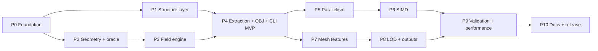

# sesmesh — Implementation Plan

| | |
|---|---|
| Document | 03 — Implementation Plan |
| Status | Draft v0.1 (for review) |
| Date | 2026-11-12 |
| Related | [01 — Product Specification](01-product-specification.md), [02 — Design](02-design.md) (section refs `D§x`) |

---

## 1. Strategy

1. **Correctness spine first.** Build the brute-force `f64` oracle and the
   analytic references (`sesmesh-testkit`) *before* the optimized engine, so
   every later optimization is checked against ground truth.
2. **Vertical slice early.** Reach an end-to-end MVP (file → OBJ) with a
   scalar-level kernel by the end of Phase 4, then make it fast (Phases 5–6),
   then complete (Phases 7–8), then prove it (Phase 9).
3. **Write SIMD-ready code once.** The field kernel is written generic over
   `fearless_simd::Simd` from the start and validated at the scalar fallback
   level; Phase 6 enables runtime dispatch and tunes, instead of rewriting.
4. **Structure layer and surface core are independent** (the core takes
   spheres), so Phases 1 and 2–3 can proceed in parallel.
5. **Every task ships with tests**; hot-path tasks also ship a benchmark.

### 1.1 Definition of done (every task)

* Code formatted (`rustfmt`), `clippy -D warnings` clean, no `unsafe`.
* Public items documented (`#![deny(missing_docs)]`), with an example when
  user-facing.
* Unit tests (and property tests where stated) pass on all CI targets.
* Hot paths: a criterion benchmark exists and results are noted in the PR.
* `CHANGELOG.md` entry; requirement IDs referenced in the PR description.

### 1.2 Milestones

| Milestone | Phases | Outcome |
|---|---|---|
| **M0** Foundation | 0 | Workspace, CI, conventions. |
| **M1** Inputs & geometry | 1, 2 | All readers, radii, selection; SAS arrangement; oracle. |
| **M2 = v0.1** MVP | 3, 4 | End-to-end CLI → OBJ, exact field, MC, analytic normals. Spec §6.1. |
| **M3 = v0.2** Fast | 5, 6 | Multi-threaded, deterministic, SIMD with runtime dispatch. |
| **M4 = v0.3** Complete | 7, 8 | Cavities, components, LOD tools, PLY/MSMS, assemblies. |
| **M5 = v1.0** Proven | 9, 10 | Validation & performance report, docs, release. Spec §6.2. |

### 1.3 Phase dependencies

### 1.4 Effort summary (one experienced Rust developer)

| Phase | Estimate (dev-days) |
|---|---|
| P0 Foundation | 1–2 |
| P1 Structure layer | 7–9 |
| P2 Geometry precompute + oracle | 6–8 |
| P3 Field engine | 5–7 |
| P4 Extraction, assembly, OBJ, CLI MVP | 7–9 |
| P5 Parallelism & determinism | 3–5 |
| P6 SIMD | 5–7 |
| P7 Mesh features | 4–6 |
| P8 LOD & extra outputs | 5–7 |
| P9 Validation & performance | 7–10 |
| P10 Docs & release | 3–4 |
| **Total** | **53–74** |

---

## 2. Dependencies (versions current on crates.io as of 2026-11-12)

| Crate | Version | Where | Purpose | Feature gate |
|---|---|---|---|---|
| `rayon` | 1.12 | lib | data parallelism | `parallel` (default) |
| `fearless_simd` | 1.2 | lib | portable SIMD, runtime dispatch | always |
| `fearless_simd_macros` | 0.1 | lib | `#[simd]` attribute | always |
| `memchr` | 2.8 | lib | fast line/byte scanning | readers |
| `fast-float2` | 0.2 | lib | float parsing from bytes | readers (benchmark vs `str::parse` first) |
| `flate2` (`zlib-rs` backend) | 1.1 | lib | gzip in/out | `gzip` (default) |
| `thiserror` | 2.0 | lib | error types | always |
| `log` | 0.4 | lib | logging facade | always |
| `rustc-hash` | 2.1 | lib | `FxHashMap` for brick lookup | always |
| `itoa` | 1.0 | lib | integer formatting | export |
| `toml` | 1.2 | lib | custom radius files | `radii-file` (default) |
| `serde`, `serde_json` | 1.0 | lib | JSON stats | `json` |
| `meshopt` | 0.7 | lib | QEM decimation (C++ meshoptimizer) | `decimate` |
| `clap` (derive) | 4.6 | cli | argument parsing | — |
| `anyhow` | 1.0 | cli | error reporting | — |
| `env_logger` | 0.11 | cli | stderr logging | — |
| `indicatif` | 0.18 | cli | progress bars | — |
| `criterion` | 0.8 | dev | micro-benchmarks | — |
| `proptest` | 1.12 | dev | property tests | — |
| `insta` | 1.49 | dev | snapshot tests | — |
| `approx` | 0.5 | dev | float assertions | — |
| `libfuzzer-sys` | 0.4 | fuzz | fuzz targets (nightly, CI scheduled only) | — |

Tools: `cargo-deny`, `cargo-fuzz`, `hyperfine` (end-to-end timing),
`samply`/Instruments (macOS) and `perf` (Linux) for profiling.
Versions are pinned to these minors at project start; the MSRV is set to the
maximum MSRV of the dependencies (checked in Phase 0) and tested in CI.

---

## 3. Phases and tasks

Task IDs are referenced in commits/PRs. "Tests" lists the minimum required.

### Phase 0 — Foundation (M0)

| ID | Task | Deliverable / tests |
|---|---|---|
| T0.1 | Create Cargo workspace: `crates/sesmesh`, `crates/sesmesh-cli` (bin `sesmesh`), `crates/sesmesh-testkit`, `xtask`; edition 2024; `[workspace.lints]` (`unsafe_code = "forbid"`, `missing_docs = "deny"`, selected clippy lints); profiles: `release` (thin LTO), `dist` (fat LTO, `codegen-units = 1`), `bench` (debug symbols). | `cargo build` / `cargo test` pass on empty crates. |
| T0.2 | CI (GitHub Actions): matrix macOS-arm64, Ubuntu x86-64, Ubuntu arm64, Windows x86-64; jobs: fmt, clippy, test (debug + release), doc (`-D warnings`), `cargo deny`, MSRV build. Scheduled nightly job for fuzz smoke runs and long tests. | Green pipeline. |
| T0.3 | Licence files (MIT, Apache-2.0), README skeleton, CONTRIBUTING (DoD from §1.1), CHANGELOG, `docs/` index. | Files present. |
| T0.4 | Test-data policy: `tests/data/` for vendored CC0 fixtures (< 5 MB total); `xtask fetch` downloads the benchmark/validation sets listed in `tests/data/sets.toml` (PDB ID, format, SHA-256) from RCSB into a git-ignored cache. | `cargo xtask fetch --set small` works. |
| T0.5 | Decide MSRV and confirm `fearless_simd` builds on all four targets (tiny smoke kernel in a scratch branch, discarded). | MSRV recorded in workspace `Cargo.toml`. |

Exit: CI green; conventions documented.

### Phase 1 — Structure layer (M1) — Spec FR-IN, FR-SEL, FR-RAD; D§5

| ID | Task | Deliverable / tests |
|---|---|---|
| T1.1 | `structure::Element`: Z 0–118 + `Unknown`, symbol parsing (case-insensitive, `D`→H isotope flag), inference from PDB atom-name field (D§5.3 rules). | Table-driven tests incl. ambiguous names (`" CA "` vs `"CA  "`, `"HG  "` vs `" HG1"`). |
| T1.2 | `AtomRecord`, `Model`, `Structure`, string interner. | Size assertion (`AtomRecord` ≤ 96 B); construction tests. |
| T1.3 | PDB reader: fixed columns, hybrid-36 decode [R41], MODEL/ENDMDL/TER, short lines, CRLF; chunked parallel parsing for files > 8 MB (sequential fallback). | Fixtures 1CRN, 1UBQ, 3FX2, 2PTN, 4HHB, 1BRS; hybrid-36 vectors from the cctbx reference; malformed-line errors with line numbers; field-by-field assertions on parsed records. |
| T1.4 | CIF lexer (D§5.4): all token kinds, zero-copy, positions for errors. | Unit tests per token kind; edge cases (quotes followed by non-space, `;` fields, comments, CRLF); fuzz target. |
| T1.5 | mmCIF `_atom_site` extraction: column mapping, defaults, model numbers, label/auth IDs. | Same fixtures as T1.3 in mmCIF: **identical atom sets** (coordinates, elements, names) to the PDB versions; a > 99 999-atom entry (e.g. 4V6X) parses; RCSB `deposited_atom_count` as independent oracle (replaces the GEMMI/pdbtbx counts originally planned). |
| T1.6 | XYZ + extended XYZ reader (frames, `Properties=` descriptor, radius column). | Hand-written fixtures; multi-frame selection; error cases. |
| T1.7 | PQR reader (with/without chain column). | Fixtures produced by PDB2PQR (vendored small file). |
| T1.8 | `io::detect` (extension + sniffing), gzip via flate2/zlib-rs, stdin. (mmap dropped: it needs `unsafe`.) | Detection matrix tests; `.gz` round trip. |
| T1.9 | `Selection`: model, alt-loc policies, hydrogens, waters, hetero, chains (auth/label), residue exclusions, predicate. | Fixtures with alt-locs (e.g. 1CRN has none → synthetic file; pick a PDB entry with alt-locs for an integration test); counts per policy. |
| T1.10 | Radii: Bondi [R34] + Mantina [R35], Alvarez [R36], ProtOr [R37] tables; custom TOML/text rules; assignment with lookup order D§5.6; unknown-element policy; warnings. | Every table value tested against transcription; rule precedence tests; warning aggregation. |
| T1.11 | Benchmarks: PDB and mmCIF parsing throughput on 4V6X (and 3J3Q when fetched). | ≥ 200 MB/s/core target noted; regressions tracked. |
| T1.12 | Fuzz targets: PDB, CIF lexer, mmCIF, XYZ, PQR (no panics, bounded memory). | Smoke run in nightly CI. |

Exit: all fixtures parse identically across formats; fuzz smoke clean.

### Phase 2 — Geometry precomputation + oracle (M1) — D§2, D§6

| ID | Task | Deliverable / tests |
|---|---|---|
| T2.1 | Internal `Vec3` (`f64`, not public), robust helpers (orthonormal basis). The `f32` kernel data is SoA, built in Phase 3. | Unit tests incl. near-degenerate cases. |
| T2.2 | `testkit` **oracle**: brute-force $F(\mathbf x)$, $\nabla F$, closest feature, over all spheres/circles/triple points with exhaustive validity (D§2.3); SAS/vdW fields. | Hand-checked cases: single sphere, two spheres (inside/outside/saddle region), three spheres with a probe pocket. |
| T2.3 | `testkit` **analytic references**: single sphere; two-sphere axisymmetric profile integration (area, volume) incl. self-intersecting torus regime; closed-form equal-radius saddle area (D§15). Random cluster generators (proptest strategies). | Cross-check closed form vs quadrature (≤ 1e-9 rel). |
| T2.4 | Morton reordering with `orig` index map (D§6.1). Frame choice moved to the field engine (Phase 3), where the grid spacing is known. | Round-trip index mapping tests. |
| T2.5 | Cell lists (counting sort, CSR) + ball range queries, generic over point sets (spheres, circles, vertices). | Property test: range query == brute force. |
| T2.6 | Neighbour CSR, containment/buried flags, duplicate collapse (D§6.3). | Property test vs brute force; sphere-in-sphere cases. |
| T2.7 | Circles + angular interval union + exposed arcs + blocker lists $K(i,j)$ (D§6.4). | Property test: arc exposure vs dense sampling of circle points (10⁴ samples) on random clusters. |
| T2.8 | SAS vertices: each triple once from circle (i,j) and blocker k > j, exposure test against N(i); sphere exposure flags. | Vertex set == exhaustive triple enumeration (N ≤ 40); symmetric configurations (C60, cubic lattice) stable and deterministic. |
| T2.9 | Benchmark arrangement on 4HHB, 1AON. | Timings recorded (D§6.4): 1CRN 3.3 ms, 4HHB 56 ms, 1AON 0.73 s, 4V6X 3.0 s single-threaded. |

Exit: arrangement matches brute force on ≥ 10⁴ random clusters; oracle and analytic references available to all crates as a dev-dependency.

### Phase 3 — Field engine (M2) — D§7

| ID | Task | Deliverable / tests |
|---|---|---|
| T3.1 | `field::lattice`: lattice anchoring, brick keys/indices, per-$B$ lane-offset tables. | Index arithmetic tests (negative coordinates, large indices). |
| T3.2 | Touched-brick set: dense bitset path and sort–dedup path (switch by lattice size). | Both paths give identical sets. |
| T3.3 | Classification: cheap SAS/vdW bounds + Lipschitz test with $\varepsilon_c$ (D§7.3). | **Soundness test**: for random clusters, every sample of every brick classified uniform has the asserted sign (oracle). |
| T3.4 | Candidate gathering with thread-local SoA scratch, nearest-first ordering, filtered blocker CSR (D§7.4). | Gathered sets ⊇ features that win/invalidate for sampled points (checked against oracle argmin). |
| T3.5 | Kernel generic over `S: Simd` with **runtime dispatch** (`f32x8`), sub-block culling, exact `f64` point evaluator (`SesField`) for large coordinate ranges and point queries (D§7.5). | Kernel samples vs oracle (≤ 1e-4 Å or exact sign in uniform sub-blocks); point field vs oracle (≤ 1e-9). |
| T3.6 | **P7 consistency**: neighbouring bricks agree on the sign of every shared sample (evaluated samples are bit-identical). | Dedicated test over all brick seams of 1CRN and random clusters. |
| T3.7 | SAS and vdW field kinds; $r_p = 0$ routing. | Oracle comparison. |
| T3.8 | `field::query`: batched point queries (value, gradient, closest feature, patch kind, nearest atom); public `SesField` wrapper. | Oracle comparison; gradient vs finite differences away from singular sets. |
| T3.9 | Benchmark (`benches/field.rs`): 1CRN, 4HHB, 1AON at 0.5/0.25 Å, auto vs scalar level. | Numbers in D§7.7. |

Exit: correct, sound field sampling on all fixtures.

### Phase 4 — Extraction, assembly, OBJ, CLI MVP (M2 = v0.1) — D§8, D§10, D§14

| ID | Task | Deliverable / tests |
|---|---|---|
| T4.1 | MC tables with uniform face-ambiguity rule; **exhaustive consistency test** over 256 cases × 6 faces (shared-face segment sets must match for every pair of compatible neighbouring configurations); winding orientation test against field gradient. | Test passes; tables generated by a documented script or verified by the test. |
| T4.2 | Per-brick MC: row trimming, owned-edge enumeration, linear vertex placement with clamping, triangle emission as edge references (D§8.2–8.3). | Single-brick tests on analytic fields (sphere, plane, torus). |
| T4.3 | Exact edge refinement (Illinois, batched `TRACK_ARGMIN`), analytic normals, patch kind, nearest atom (D§8.2). | Vertices within 10⁻⁴ Å of SES (oracle); normal angle error ≤ 0.1° off singular curves. |
| T4.4 | Global assembly: brick ordering, prefix sums, cross-brick reference resolution (sequential implementation first, parallel-ready data layout). | Manifold, watertight meshes across seams; no duplicate vertices. |
| T4.5 | `mesh::validate` (D§9.3) and `mesh::measure` (area, signed volume, χ). | Unit tests on hand-built meshes; used as assertion in all integration tests. |
| T4.6 | OBJ writer: fast fixed-point formatter, header (D§10.1), `--no-normals`, precision; streaming `BufWriter`. | Formatter exhaustive tests vs `format!` on random values; snapshot test of a small OBJ; re-parse test (own minimal OBJ reader in testkit). |
| T4.7 | `SurfaceParams` (presets, validation of ranges), `SurfaceEngine` orchestration, `compute_surface`, stats and diagnostics (D§4, D§13). | API doc examples compile and run (doctests). |
| T4.8 | CLI: `surface` (input/selection/radii/surface/resolution/output core options), `info`, `radii`; exit codes; human-readable stats on stderr. | `assert_cmd`-style integration tests (spawn binary) on fixtures; usage errors → exit 2. |
| T4.9 | Accuracy integration tests: single sphere and two-sphere configurations (incl. self-intersecting torus) at $h \in \{1, 0.5, 0.25, 0.125\}$; convergence order ≈ 2. | Meets NFR-ACC analytic bounds. |
| T4.10 | Manual smoke check: open meshes of 1CRN/4HHB in Blender, MeshLab, ChimeraX; screenshots in PR. | Recorded in PR. Done: 1CRN reviewed by the user ("the surface is perfect"). |

Exit (v0.1): Spec §6.1 acceptance criteria met; tag `v0.1.0` (not published).

> Status (Phase 4 done; T4.10 viewer check done by the user):
> * T4.1: table generated by a test-only generator; triangulations also avoid
>   diagonals inside cube faces (a neighbour could repeat them).
> * T4.3: safeguarded Newton with Illinois fallback instead of pure Illinois
>   (2.2–2.5 evaluations per vertex); scalar `f64` evaluations per vertex,
>   batched SIMD refinement moved to T6.3.
> * T4.4 is parallel already (per-brick meshing and reference resolution);
>   T5.4's parallel chunked OBJ formatting was also done here.
> * T4.5: `mesh::validate`, `mesh::components` (area, signed volume, χ per
>   component; part of T7.1) and `mesh::area_volume`.
> * T4.7: `compute_surface` and `SurfaceParams`; the reusable `SurfaceEngine`
>   moves to Phase 5 with cancellation/progress (T5.6).
> * T4.8: integration tests spawn the binary with `std::process::Command`
>   (no `assert_cmd` dependency).
> * T4.9: convergence order ≈ 2 verified; NFR-ACC volume bound not met for
>   single small spheres at 0.25 Å (Design §15 "Measured").

### Phase 5 — Parallelism and determinism (M3) — D§11.1

> Moved forward on request: T5.1 (`par` facade), parallel arrangement
> (part of T5.2) and parallel brick classification/sampling (part of T5.3)
> were implemented in Phase 3, with a 1 vs N threads checksum test (part of
> T5.5). Phase 4 added parallel meshing, assembly resolution and chunked OBJ
> formatting (T5.3, T5.4) with a byte-identical 1/2/4/7-thread test.
>
> Status (Phase 5 done): `SurfaceEngine` (from T4.7) with a per-thread
> buffer pool; T5.6 `Control` (cancel flag + progress callback),
> `compute_surface_with`, `Error::Cancelled`, CLI `--progress` (own
> stderr line instead of `indicatif`; Ctrl-C is not wired: it would need a
> signal-handling dependency); T5.5 determinism suite (`tests/determinism.rs`:
> 1/2/4/8/16 threads and repeated runs on 1CRN and 2PTN, nightly 4HHB and
> 1AON); T5.7 scaling study and `benches/scaling.rs` (Design §11.1: ≈ 80 %
> efficiency on 4 performance cores, 4.5–4.9× on 10 heterogeneous cores);
> hotspot fixed: parallel components and validation (measure stage −45 %).

| ID | Task | Deliverable / tests |
|---|---|---|
| T5.1 | `par` facade (rayon or sequential), `parallel` feature, respect caller's pool. | Builds and tests pass with `--no-default-features --features pdb,mmcif`. |
| T5.2 | Parallel precompute: cell lists, neighbours, circles/arrangement, touched bricks, classification. | Outputs identical to sequential (order-normalized). |
| T5.3 | Parallel surface-brick pipeline (gather → kernel → MC → refinement) with `for_each_init` scratch and indexed result collection. | Identical mesh to sequential. |
| T5.4 | Parallel assembly resolution; parallel chunked OBJ formatting with bounded in-flight memory. | Byte-identical OBJ vs sequential. |
| T5.5 | Determinism suite: 1/2/4/8/16 threads byte-identical; repeated runs; fixed-order float reductions. | CI test on 1CRN + 4HHB; nightly on 1AON. |
| T5.6 | Cancellation (`AtomicBool`) and progress callback; CLI `--progress` (indicatif). | Cancel test returns `Error::Cancelled` promptly (< 100 ms after flag). |
| T5.7 | Scaling benchmark (1AON, 1JJ2): speedup curve 1–16 threads; fix hotspots (false sharing, allocation, load imbalance via `with_min_len`). | ≥ 75 % efficiency at 8 cores or documented analysis. |

### Phase 6 — SIMD (M3) — D§7.5, D§11.2

> Moved forward on request: T6.1 (level detection, dispatch, `SimdLevel`
> override) and the core of T6.2 (SIMD sampling kernel) were implemented in
> Phase 3, with an auto-vs-scalar agreement test (part of T6.4). Remaining:
> kernel tuning, SIMD refinement batches if needed, CI coverage of x86
> levels, speed-up measurements on x86.
>
> Status (Phase 6 done, with documented analysis instead of the x86
> speed-up targets, which need x86 hardware):
> * T6.1: `SimdLevel::{Sse4_2, Avx2, Avx512, Neon}` and CLI `--simd`
>   capped at the detected level (`SimdLevel::effective`); other-architecture
>   levels are usage errors.
> * T6.2: profiled and measured (Design §7.5 "Kernel experiments"); the
>   deep-inside shortcut was slower and reverted; default brick size 8 → 10
>   (4–10 % faster end to end).
> * T6.3: instead of an `f32` SIMD batch, exact `f64` refinement over
>   per-sub-block candidate lists with locally restricted blockers (a local
>   evaluation costs about the kernel's per-sample cost; Design §7.5).
> * T6.4: not done — MC case classification is ≈ 2 % of the profile.
> * T6.5: test at 10⁴ Å offsets (f32 frame centred on the molecule) and at
>   5 000 Å extent (automatic `f64` path); it exposed `f32` vertex collapse,
>   fixed by an ulp-aware edge clamp (Design §8.2).
> * T6.6: per-level agreement test on every CI runner, level matrix in the
>   CI job summary; AVX-512 is covered where the runner has it (no Intel SDE
>   job).
> * T6.7: field benchmark at every available level; on Apple Silicon NEON is
>   only ≈ 10 % faster than the autovectorized fallback (Design §7.5), x86
>   numbers to be collected in Phase 9.

| ID | Task | Deliverable / tests |
|---|---|---|
| T6.1 | `Level` detection at engine creation, one `dispatch!` per brick batch; `--simd` override (cap at detected level). | Selected level reported in stats/`--timings`. |
| T6.2 | Kernel optimization at native width: SoA candidate buffers, nearest-first order, lower-bound skips, masked validity with early exit, padded tails (no scalar tail path). | Per-level equivalence vs oracle and vs fallback (≤ 10⁻⁵ Å); P7 test at every level. |
| T6.3 | SIMD batches for edge refinement and point queries (re-projection, validation). | Same equivalence tests. |
| T6.4 | Optional SIMD MC case classification (8 corner signs → case byte) if profiling shows benefit. | Benchmark-justified only. |
| T6.5 | `f64` kernel path for extents > 4 000 Å; automatic selection. | Test with coordinates offset by 10⁴ Å. |
| T6.6 | CI coverage of levels: x86 runners (SSE4.2/AVX2; AVX-512 where available or via Intel SDE in nightly), arm64 (NEON). | Level matrix in CI summary. |
| T6.7 | Benchmarks: kernel speedup per level; end-to-end on the benchmark set. | ≥ 3× AVX2, ≥ 2× NEON over fallback, or documented analysis. |

Exit (v0.2): fast, deterministic, multi-level SIMD.

### Phase 7 — Mesh features (M4) — D§9, FR-SURF-4..7, FR-MESH-6, FR-OUT-2/5/6/7

> Starting point (from Phases 4–5): `mesh::components` already gives
> deterministic component ids with area, signed volume, χ, genus and
> `is_cavity` (most of T7.1), and `Mesh` carries `vertex_atom` (input sphere
> index) and `vertex_patch`. The default element palette for vertex colours
> (T7.5) is the user-provided `atom-colors.json` (118 elements, hex colours;
> see `AGENTS.md`).
>
> Status (Phase 7 done):
> * T7.1: triangles grouped by component (`Component::first_triangle`,
>   `Mesh::vertex_component`); genus test on a 20-atom ring (χ = 0),
>   separated molecules; 2PTN cavity comparison with EDTSurf/NanoShaper
>   numbers moves to Phase 9 (needs the reference data).
> * T7.2: `CavityMode`, `min_cavity_volume`, `min_component_area`, removal of
>   components inside removed cavities (ray parity), vertex compaction; test
>   on a hollow atom shell with a core atom.
> * T7.3: `mesh::atom_areas`, CLI `--atom-areas` (sum equals the mesh area).
> * T7.4: `NormalMode::{Analytic, FaceAverage, None}`; CLI `--face-normals`,
>   `--no-normals`.
> * T7.5: OBJ groups and vertex colours (element/chain/patch/component;
>   palette from `atom-colors.json`, `--palette` override), `--vertex-data`
>   CSV, `--stats` JSON written by the CLI (`serde_json`) instead of a library
>   `json` feature; formats in `docs/04-output-formats.md`.

| ID | Task | Deliverable / tests |
|---|---|---|
| T7.1 | Components (union–find, deterministic ids), per-component area/volume/χ/genus, triangle reordering by component. | Synthetic multi-molecule inputs; genus tests (torus-shaped atom ring). |
| T7.2 | Cavity classification (signed volume) and `keep/remove/only`, enclosure test for nested components, volume/area filters (D§9.2). | Synthetic hollow shell of atoms with an inner molecule; 2PTN cavities (compare count/volumes with EDTSurf/NanoShaper reference numbers, D§15). |
| T7.3 | Per-atom area attribution; CSV output. | Sum of atom areas == total area (fixed-order sum). |
| T7.4 | Normal modes: analytic (default), face-average, none. | Unit tests. |
| T7.5 | OBJ options: per-component groups, vertex colours (element/chain/patch/component palettes), per-vertex CSV side file; JSON stats (`json` feature). | Snapshot tests; JSON schema documented in `docs/`. |

### Phase 8 — Level of detail and extra outputs (M4) — FR-LOD, FR-OUT, FR-IN-8, FR-CLI-5

| ID | Task | Deliverable / tests |
|---|---|---|
| T8.1 | Vertex-density mode (`--density`) with provisional constant (D§8.6); calibrated in T9.5. | Achieved density within ±25 % on fixtures (tightened after calibration). |
| T8.2 | Memory estimation and `--max-memory` guard (refuse or auto-coarsen on request). | Exit code 4 path tested. |
| T8.3 | Taubin smoothing + exact re-projection + normal/attribute recomputation (D§9.4). | Vertices remain within tolerance of SES; triangle quality metric (min angle histogram) improves. |
| T8.4 | Decimation via `meshopt` (feature `decimate`): ratio/target/error options, vertex compaction, attribute remap, re-validation (D§9.5). | Manifold after decimation on fixtures; retained vertices still on SES. |
| T8.5 | PLY binary writer (with attributes), MSMS `.vert/.face` writer, gzip output, stdout output. | Round-trip with own PLY reader (testkit); MSMS format snapshot vs manual. |
| T8.6 | Biological assemblies (mmCIF `pdbx_struct_assembly_gen`/`oper_list`, PDB BIOMT) and `--assembly`. | 1K4R assembly 1 atom count (≈ 545 k [R15]); operator-expression parser tests (`(1-60)`, `(1,2)(3-5)`). |
| T8.7 | Batch mode (`--output-dir`, `--keep-going`), shell completions (C). | Integration test with a failing input among good ones. |

Exit (v0.3): all Must/Should requirements implemented.

> Status (Phase 8 done except T8.4 and completions):
> * T8.1: `Resolution::Density`, `--density` (constant 1.5 confirmed on
>   crambin; calibration on the validation set stays in T9.5).
> * T8.2: `estimate_memory` after classification, `max_memory` /
>   `--max-memory` (exit code 4); refusal only, no auto-coarsening.
> * T8.3: Taubin smoothing + exact re-projection (`--smooth N`), tested on
>   vertex distance, sliver count and area.
> * T8.4: **deferred** — decimation via `meshopt` adds an optional C++
>   dependency; candidates: `meshopt` behind `decimate` or a pure-Rust QEM.
> * T8.5: binary PLY and MSMS writers (gzip output and stdout already
>   existed for OBJ; PLY also writes to stdout); testkit PLY reader.
> * T8.6: mmCIF/PDB assemblies (`ReadOptions::assembly`,
>   `io::read_assemblies`, `--assembly`, `info` listing); 1K4R assembly 1 =
>   545 040 atoms (meshed at 1 Å: 9.8 M triangles in ≈ 10 s, 10 cores).
> * T8.7: batch mode (`--output-dir`, `--keep-going`); shell completions
>   (C) not done.

### Phase 9 — Validation and performance campaign (M5) — NFR-PERF/ACC/ROB/DET

| ID | Task | Deliverable / tests |
|---|---|---|
| T9.1 | **Validation corpus**: ≈ 50 PDB entries spanning 300 – 240 k atoms (incl. 1CRN, 1UBQ, 3FX2, 2PTN, 1BRS, 1ECA, 4HHB, 1AON, 1JJ2, 4V6X) + synthetic analytic set; listed in `tests/data/sets.toml`. | Set fetched by `xtask`. |
| T9.2 | **Offline references** on a developer machine: MSMS (density ≥ 20, explicit radii file, probe 1.4), NanoShaper (≥ 4 grids/Å), EDTSurf (high resolution), sesa (analytic area) [R9, R12, R13, R21]; store only resulting numbers with tool version and exact command lines (`tests/data/reference/*.toml`). Same radii fed to all tools. | Reference files committed. |
| T9.3 | Accuracy study: area/volume error vs $h$ for every corpus entry; convergence plots; per-atom area comparison (sesa style); `docs/validation-report.md`. | NFR-ACC met or deviations explained. |
| T9.4 | **Robustness sweep**: ≥ 1 000 randomly sampled PDB entries (mmCIF) at 0.5 Å — no errors except documented input problems; all meshes manifold (NanoShaper-style stress test [R13]); degenerate synthetic corpus (D§15). | Sweep report; zero crashes. |
| T9.5 | Performance tuning: brick size {4, 6, 8, 12, 16}, sub-brick culling on/off, gather radius, rayon granularity, allocation reuse, refinement iterations; profile with samply/perf. Calibrate density constant and presets. | Tuned defaults committed with benchmark evidence. |
| T9.6 | Benchmark report on both reference machines vs ChimeraX, EDTSurf, NanoShaper, MSMS where they run (same inputs, same spacing/density; wall time and peak RSS). `docs/benchmarks.md`. | NFR-PERF met or targets revised with justification. |
| T9.7 | Large inputs: 4V6X at 0.5 Å, 3J3Q at 1.0 Å, 1K4R assembly at 1.0 Å — time, peak memory. | Within NFR-MEM. |
| T9.8 | Fuzzing campaign: ≥ 24 CPU-hours per parser target; fix findings; add regressions to corpus. | Clean campaign log. |

### Phase 10 — Documentation and release (M5 = v1.0)

| ID | Task | Deliverable / tests |
|---|---|---|
| T10.1 | Rustdoc: crate guide (concepts: SES/SAS/vdW, resolution, cavities, determinism), every public item; `examples/` (basic file → OBJ, spheres → mesh, trajectory reuse, custom radii, field queries). | `cargo doc` clean; examples run in CI. |
| T10.2 | CLI manual `docs/cli.md` (all options, examples, exit codes); `--help` texts reviewed. | — |
| T10.3 | API review against the Rust API Guidelines checklist; `#[non_exhaustive]` audit; semver policy. | Checklist in PR. |
| T10.4 | Release automation: GitHub release binaries for tier-1 targets (`dist` profile), checksums; crates.io publish order (`sesmesh` then `sesmesh-cli`). | Dry-run release. |
| T10.5 | README with quick start, screenshots, citation section (cite the methods the implementation is based on: [R6], [R22], etc.). | — |

Exit (v1.0): Spec §6.2 release criteria.

---

## 4. Test data plan

| Set | Content | Storage |
|---|---|---|
| `fixtures` | 1CRN, 1UBQ, 3FX2, 2PTN (PDB + mmCIF), small XYZ/extXYZ/PQR files, malformed files, alt-loc examples | vendored (CC0), < 5 MB |
| `analytic` | Generated in tests (single/two/three spheres, symmetric clusters, C60) | generated |
| `small` | + 4HHB, 1BRS, 1ECA | `xtask fetch` |
| `bench` | 1AON, 1JJ2, 4V6X, 3J3Q, 1K4R | `xtask fetch` (≈ 300 MB gz) |
| `validation` | ≈ 50 entries (T9.1) | `xtask fetch` |
| `sweep` | ≥ 1 000 random entries (T9.4), seed recorded | `xtask fetch --set sweep --seed N` |
| `reference` | Offline numbers from external tools with provenance | vendored TOML |

PDB archive data is CC0; external tools' outputs are not vendored, only
derived numbers.

## 5. Benchmark protocol

* Machines: (A) Apple Silicon 8 P-cores, macOS; (B) x86-64 8C/16T with AVX2
  (and AVX-512 if available), Linux. Fixed CPU frequency where possible;
  report core counts, compiler version, `dist` profile.
* Micro (criterion): CIF lexer, PDB parser, arrangement, kernel per SIMD
  level (samples/s), MC per brick, assembly, OBJ formatting (MB/s).
* Macro (`hyperfine --warmup 2 --runs 10`): CLI on the bench set at 1.0 / 0.5
  / 0.25 Å; peak RSS via `/usr/bin/time -l` (macOS) / `-v` (Linux).
* Results stored as CSV under `docs/benchmarks/` and summarized in
  `docs/benchmarks.md`; CI tracks micro-benchmark regressions (> 10 %) on a
  nightly job (informational).

## 6. Risk burn-down order

| Risk (Design §16) | Retired by |
|---|---|
| Field correctness / completeness of candidate classes | T2.2, T3.5 (oracle comparisons) |
| Brick-seam cracks | T3.6 (P7), T4.1 (MC table consistency), T4.4 |
| Kernel throughput | T3.9 baseline → T6.7; fallback plans: sub-brick culling, brick size (T9.5) |
| Precompute cost on multi-million-atom inputs | T2.9 → T9.7 |
| Cavity semantics | T7.2 + documentation |
| Determinism | T5.5, T6.2 |
| Parser robustness | T1.12, T9.8, T9.4 |

## 7. Work streams for parallel development

After Phase 0, three streams can run concurrently with minimal coupling:

1. **Structure layer** (P1, then T8.6 assemblies) — depends only on
   `structure` types.
2. **Geometry + field** (P2 → P3 → P6) — depends only on `Sphere` input and
   `testkit`.
3. **Mesh + export** (T4.1, T4.5, T4.6 early, against analytic fields; then
   P7/P8) — depends only on a field-sampling trait, testable with analytic
   sphere/torus fields.

Integration happens in T4.7/T4.8 (engine + CLI).

## 8. Open items to settle before Phase 1

Carried over from Spec §10 (proposed defaults in brackets): cavity default
[`keep`], radius default [Bondi + Mantina], H/waters excluded [yes], default
spacing [0.5 Å], name [`sesmesh`], licence [MIT OR Apache-2.0], assemblies in
v1 [yes], output format priority [PLY, MSMS].
