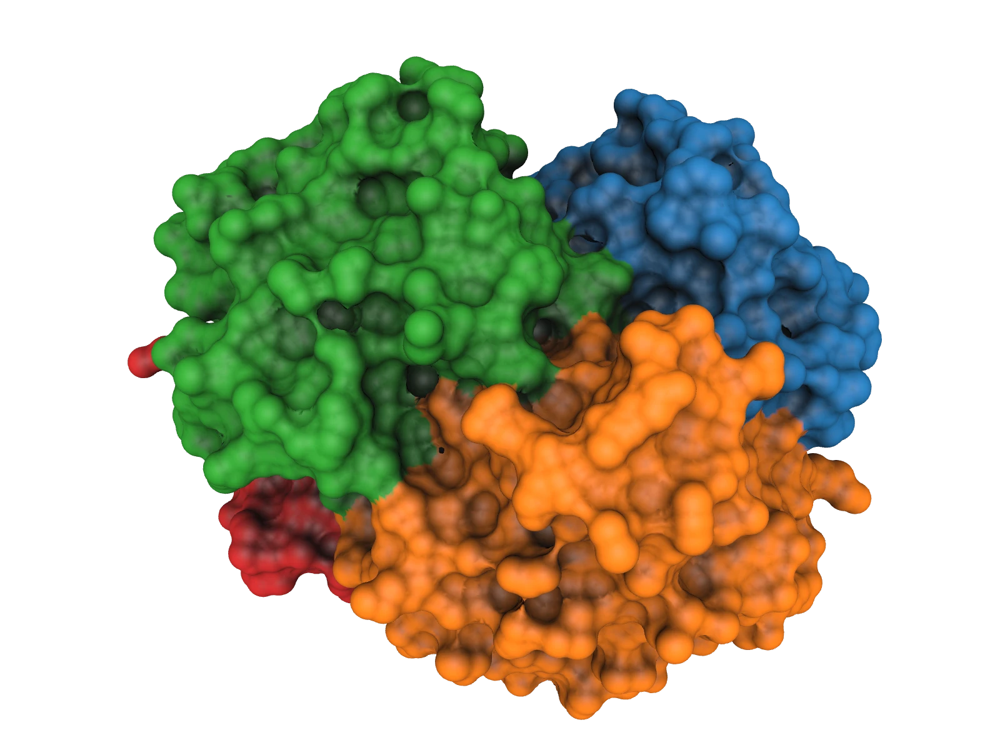

# Ambient occlusion with aomesh

Ambient occlusion (AO) darkens the parts of a surface that little light
reaches: pockets, clefts, the seams between chains. It makes the shape of a
molecular surface readable in any viewer, without changing the geometry.

sesmesh does not compute it. [aomesh](https://github.com/uvar-apps/aomesh), a
separate program, bakes it into any OBJ mesh as a post-processing step, and
`ses_ao.py` here chains the two:

```
structure ──sesmesh──▶ <stem>.obj ──aomesh──▶ <stem>_ao.obj + .mtl + .png  (+ .ply with --bake-colors)
```



## What aomesh writes

| File | Content |
|---|---|
| `<stem>_ao.obj` | The sesmesh surface unchanged (positions, colours, normals, groups, header), plus one `vt u u` per vertex: its AO value |
| `<stem>_ao.mtl` | One white material, `map_Kd <stem>_ao.png` |
| `<stem>_ao.png` | A 256 × 1 grey ramp, black at the left (occluded) to white at the right (open) |

A renderer looks each vertex's coordinate up in the ramp and multiplies the
diffuse colour by that grey, so the AO shows with no special support. The
value is the cosine-weighted share of viewpoints on a sphere around the mesh
(256 by default, in front of the vertex's normal) that see the vertex:
1 for open surface, 0 where nothing outside reaches. The coordinate is
`u = (0.5 + 255·ao)/256`, so `ao = (256·u − 0.5)/255`.

`--bake-colors` adds `<stem>_ao.ply`: a binary PLY laid out like sesmesh's
(`x y z`, `nx ny nz`, `red green blue`, triangles) whose vertex colours are
the surface colours times the AO value (`--strength 0–1` scales the
darkening). Without `--vertex-colors` the surface is white, so the PLY holds
AO alone in grey. Use it for viewers that show vertex colours but not
textures, for MeshLab, or to combine AO with colours where a viewer will not
multiply the two.

## Requirements

* sesmesh 1.x (`cargo install sesmesh-cli`), and aomesh 0.4.0 or later
  (`cargo install aomesh-cli`). Older aomesh releases write
  `map_Kd -imfchan l …`, which three.js reads as part of the file name, and
  drop the OBJ's groups and header comments; the script warns about them.
* Python 3.8 or later, standard library only.

The script finds the programs from `--sesmesh` / `--aomesh`, the `SESMESH` /
`AOMESH` environment variables, `PATH`, then this checkout's
`target/release/`.

## Usage

```bash
python3 tools/ao/ses_ao.py INPUT... [options] [-- sesmesh options]
```

| Option | Default | Meaning |
|---|---|---|
| `-o, --output-dir DIR` | `.` | Where the outputs go (created if missing) |
| `--samples N` | 256 | aomesh viewpoints; cost is linear in N |
| `--bake-colors` | off | Also write `<stem>_ao.ply` with colours × AO |
| `--strength S` | 1 | With `--bake-colors`: 0 leaves the colours alone, 1 is full AO |
| `--preview` | off | Keep aomesh's validation image `<stem>_ao_preview.png` |
| `--keep-surface` | off | Keep sesmesh's surface as `<stem>.obj` |
| `--keep-going` | off | With several inputs, continue after a failure (exit status 1 at the end) |
| `--sesmesh PATH`, `--aomesh PATH` | | The programs to run |
| `--quiet` | off | Print errors only |

Everything after `--` goes to `sesmesh surface` unchanged (see
[`docs/cli.md`](../../docs/cli.md)), except the output options `-o`,
`--output`, `--output-dir` and `--output-format`, which the script owns. An
input ending in `.obj` is taken as an existing surface and only baked. A
failing step stops with that program's exit status.

## Examples

Crambin with element colours, at the 0.25 Å grid:

```bash
python3 tools/ao/ses_ao.py data/1crn.cif -o out -- -q high --vertex-colors element
# out/1crn_ao.obj, out/1crn_ao.mtl, out/1crn_ao.png
```

Haemoglobin coloured by chain, with the coloured PLY too (the figure above;
about 6 s on a 10-core M4 for 320 764 vertices):

```bash
curl -LO https://files.rcsb.org/download/4HHB.cif.gz
python3 tools/ao/ses_ao.py 4HHB.cif.gz -o out --bake-colors \
    -- -q high --vertex-colors chain --decimate 0.5
```

GroEL–GroES: aomesh's time and memory grow with the vertex count (2.2 M
vertices at 0.5 Å took 32 s and 3.1 GB), so cap the triangles first; 1 M
triangles bake in about 7 s:

```bash
curl -LO https://files.rcsb.org/download/1AON.cif.gz
python3 tools/ao/ses_ao.py 1AON.cif.gz -o out --bake-colors \
    -- -s 0.5 --cavities remove --vertex-colors chain --max-triangles 1000000
```

Components as groups: with `--group-components` the OBJ keeps one group per
component through the bake, so a viewer can hide or colour each:

```bash
python3 tools/ao/ses_ao.py data/1crn.cif -o out -- -q high --group-components
```

Re-bake an existing surface with more viewpoints, without meshing again:

```bash
python3 tools/ao/ses_ao.py out/1crn.obj -o out --samples 1024
```

Several inputs in one run:

```bash
python3 tools/ao/ses_ao.py data/*.cif -o out --keep-going -- -s 0.5 --vertex-colors element
```

## Opening the result

* **three.js** (`OBJLoader` + `MTLLoader`): loads the texture; groups become
  separate meshes. Set `material.vertexColors = true` to multiply the
  surface colours by the AO, or load the PLY with `PLYLoader` and
  `vertexColors: true`.
* **Blender**: File ▸ Import ▸ Wavefront (.obj) wires the ramp into Base
  Color; tick *Split by Group* to get one object per component. For colours ×
  AO, add a *Mix* node (Multiply) between the *Color Attribute* and the image
  texture, or import the PLY and feed its *Color Attribute* into Base Color.
* **MeshLab**, **ParaView** and other PLY viewers: open `<stem>_ao.ply`
  (`--bake-colors`).

Both the three.js and the Blender (5.3) routes were checked with the
outputs of this script; the MeshLab and ParaView routes rely on their PLY
vertex-colour support.

## Caveats

* Cavities are black. AO here measures what an outside viewpoint can see, and
  no viewpoint sees an internal cavity (crambin's: 0 everywhere). It does not
  matter when the outer surface is shown, but for pictures of cavities alone
  (`--cavities only`) use plain colours, and `--cavities remove` saves aomesh
  the work when cavities will not be shown.
* The AO is per vertex, interpolated across triangles: the mesh resolution is
  the AO resolution. Decimated meshes keep fewer, larger triangles in flat
  areas, where AO changes slowly anyway.
* The ramp is an ordinary 8-bit image: renderers that decode textures as sRGB
  darken the middle greys a little, as for any texture.
* `--bake-colors` reads the whole OBJ in Python: about 2.5 s per 640 k
  vertices.

## Tests

```bash
python3 -m unittest discover -s tools/ao
```

The end-to-end tests run sesmesh and aomesh on crambin and are skipped when
either is missing or aomesh is older than 0.4.0.
